<p align="center">
  
</p>

<h1 align="center">AfyaMkononi</h1>

<p align="center">
  Telemedicine for Kenya: verified doctors, peer navigators and patients on one secure platform.<br>
  <sub>Codename <strong>HelloDoctor</strong> · Patient app · Care app · Doctor Web · Admin Web · Rust API</sub>
</p>

<p align="center">
  <a href="https://github.com/MeherabHS/hellodoctor/actions/workflows/application-checks.yml"></a>
  <a href="https://github.com/MeherabHS/hellodoctor/actions/workflows/backend-migrations.yml"></a>
  <a href="https://github.com/MeherabHS/hellodoctor/actions/workflows/security-scan.yml"></a>
</p>

---

## Contents

1. [Overview](#overview)
2. [Credits and partnerships](#credits-and-partnerships)
3. [Product surfaces](#product-surfaces)
4. [Architecture](#architecture)
5. [Repository layout](#repository-layout)
6. [Getting started](#getting-started)
7. [Testing](#testing)
8. [Deployment](#deployment)
9. [Debugging and troubleshooting](#debugging-and-troubleshooting)
10. [Screenshots](#screenshots)
11. [Security, privacy and business rules](#security-privacy-and-business-rules)
12. [Performance](#performance)
13. [Documentation map](#documentation-map)
14. [Ownership](#ownership)

---

## Overview

AfyaMkononi lets patients in Kenya book and hold chat and video consultations with KMPDC-verified
doctors, keep their records and reminders, and reach trained peer navigators. Doctors run their
queue, consultations, prescriptions and earnings from a mobile app or a web workstation, and
administrators verify clinicians, publish health content and handle grievances.

> AfyaMkononi is the Kenyan patient and doctor mobile application operated by Global Health
> Initiatives (GHI) under the AfyaMkononi.app platform name. Research and Management Consultants
> Ltd. (RMCL) provides agreed technology and operational services under its partnership with GHI.

Highlights:

- **Bilingual**: English and Kiswahili, switchable instantly.
- **Live consultations** over Agora RTC with server-minted, join-window-gated tokens.
- **Clinical chat** with read receipts, adaptive polling and encrypted, lifecycle-controlled attachments.
- **No star ratings**: clinicians are represented by KMPDC registration, experience and verified affiliations; dissatisfaction goes through a structured grievance process.
- **Defence in depth**: row-level security forced on every table, five least-privilege database roles, admission control and per-account limits, Argon2id, device-bound sessions.

## Credits and partnerships

| Role | |
|---|---|
| **Design and engineering** | **Meherab Hossain** ([@MeherabHS](https://github.com/MeherabHS)): product engineering, architecture, backend, mobile and web applications, infrastructure and assurance |
| **Operator** | [Global Health Initiatives (GHI)](https://www.globalhealthinnovations.org): Kenyan operator of AfyaMkononi and of the clinical telehealth service |
| **Technology partner** | [Research and Management Consultants Ltd. (RMCL)](https://rm-consultants.asia): agreed technology and operational services under its partnership with GHI |

## Product surfaces

| Surface | Path | Stack | Users |
|---|---|---|---|
| Patient app | [`apps/mobile_patient`](apps/mobile_patient) | Flutter (Android, iOS) | Patients and their dependants |
| Care app ("AfyaMkononi Care") | [`apps/mobile`](apps/mobile) | Flutter (Android, iOS) | Doctors and peer navigators |
| Doctor Web | [`apps/doctor-web`](apps/doctor-web) | Next.js + TypeScript (BFF) | Doctors at a workstation |
| Admin Web | [`apps/admin-web`](apps/admin-web) | Next.js + TypeScript (BFF) | Platform administrators |
| Public website | [`apps/afyamkononi-website`](apps/afyamkononi-website) | Static HTML/CSS/JS | Public, legal pages |
| Core API | [`services/backend`](services/backend) | Rust, Axum, Tokio, SQLx | All of the above |

## Architecture

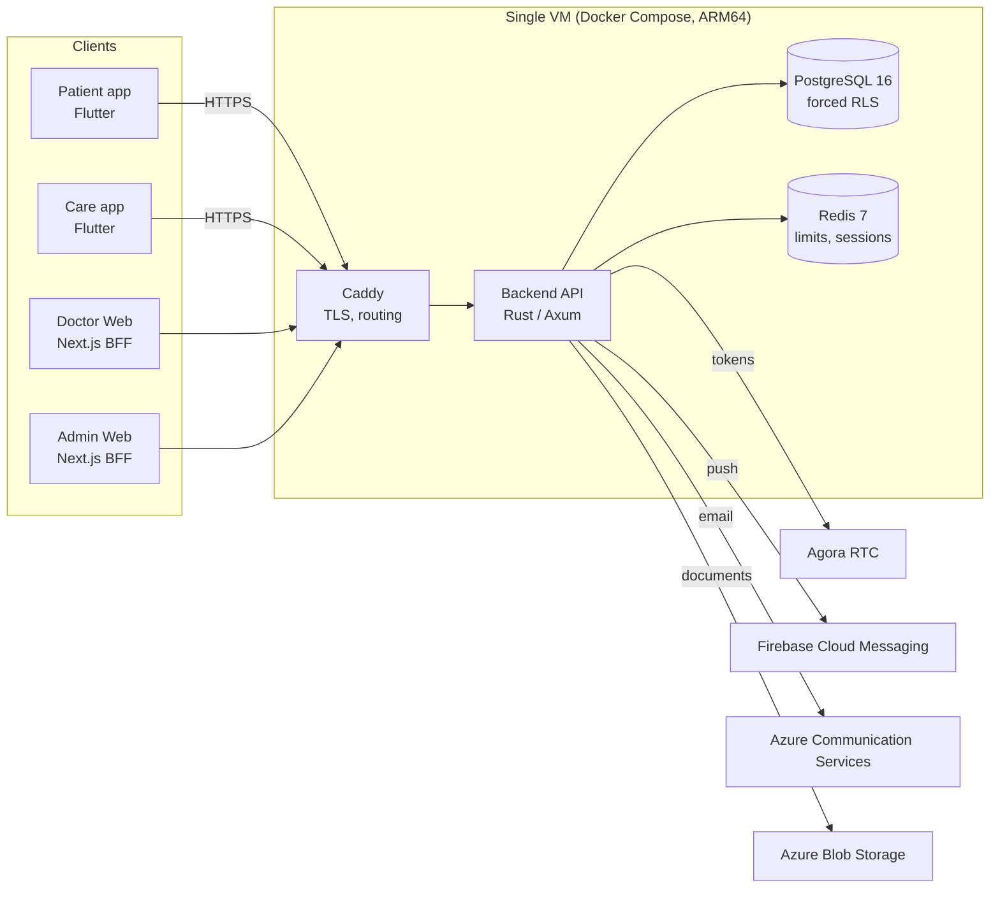

| Layer | Choice | Notes |
|---|---|---|
| API | Rust 2021, Axum 0.7, Tokio, Tower | Admission control per traffic class, structured errors, Prometheus metrics |
| Data | PostgreSQL 16 via SQLx | 130+ reversible migrations; RLS enabled **and forced**; separate API, auth, payment, system and finance roles |
| Cache and limits | Redis 7 | Rate limits, abuse jails, OTP and session state; fails closed |
| Real-time | Agora RTC (video/audio), HTTP polling (chat) | No custom WebRTC signalling; Agora App Certificate stays on the server |
| Mobile | Flutter 3.47, flutter_bloc | Feature-first modules; secure storage per purpose; offline-aware screens |
| Web | Next.js, TypeScript | Backend-for-frontend proxies with route allow-lists |
| Notifications | FCM + local alarms | Forced sounds, alarm-channel reminders, in-app inbox as the source of truth |
| Hosting | Docker Compose on an Azure ARM64 VM (Cobalt 100) | Images published to GHCR by digest |

Design decisions are recorded in [`docs/ADR`](docs/ADR).

## Repository layout

```text
.
├── apps/
│   ├── mobile_patient/        Patient Flutter app
│   ├── mobile/                Care Flutter app (doctors, peer navigators)
│   ├── doctor-web/            Doctor web workstation (Next.js)
│   ├── admin-web/             Admin console (Next.js)
│   └── afyamkononi-website/   Public website and legal pages
├── services/
│   └── backend/
│       ├── src/               api/, domain/, repository/, services/, admission.rs, rate_limit.rs
│       ├── migrations/        SQLx up/down migrations
│       ├── tests/             Integration and API tests (sqlx::test)
│       ├── examples/          Load, auth-stress and admin tooling
│       └── scripts/           Schema verification, seeding, assurance harness
├── deploy/
│   └── single-vm/             Compose files, Caddyfiles, backup overlay, nightly error digest
├── ops/                       Disaster-recovery drills, local measurement
├── docs/                      Specifications, runbooks, ADRs, design references, assurance pack
└── .github/workflows/         CI: checks, migrations, security scan, ARM64 image publishing, APK builds
```

## Getting started

### Prerequisites

| Tool | Version |
|---|---|
| Rust | stable (edition 2021) with `cargo`, `clippy`, `rustfmt` |
| `sqlx-cli` | `cargo install sqlx-cli --no-default-features --features postgres,rustls` |
| PostgreSQL | 16 |
| Redis | 7 |
| Flutter | 3.47.6 |
| Node.js | 24 |
| Docker | Engine with Compose v2 (for the full stack) |

### 1. Backend

```bash
cp .env.example services/backend/.env      # then fill in local values; never commit real secrets
cd services/backend
sqlx migrate run
cargo run                                   # http://localhost:8080, health at /healthz
```

`ENVIRONMENT=development` with `SEED_DEV_DATA=true` seeds synthetic accounts.
`DEV_AUTH_OTP_ENABLED` exposes one-time codes for local sign-in only; it is refused outside development.

### 2. Web apps

```bash
cd apps/admin-web  && npm install && npm run dev    # http://localhost:3000
cd apps/doctor-web && npm install && npm run dev    # http://127.0.0.1:3001
```

### 3. Mobile apps

```bash
cd apps/mobile_patient            # or apps/mobile
flutter pub get
flutter run --dart-define=API_BASE_URL=https://<your-api>/api/v1
```

The default `API_BASE_URL` is `http://10.0.2.2:8080/api/v1` (the host machine from an Android
emulator). Plain HTTP is refused unless the build sets `ENVIRONMENT=development` and
`ALLOW_INSECURE_HTTP=true`. Push notifications need `google-services.json`, which is not committed
(see [FCM setup](docs/FCM_SETUP.md)). Care app screens can be opened without signing in through
its design-preview entry point: `flutter run -t lib/dev/design_preview_main.dart`.

### 4. Full stack in containers

```bash
cd deploy/single-vm
cp ../../.env.example .env        # production-shaped settings; see the operator runbook
docker compose up -d
```

## Testing

| Component | Command | Notes |
|---|---|---|
| Backend | `cargo fmt --check && cargo clippy --all-targets -- -D warnings && cargo test -- --test-threads=1` | Needs `DATABASE_URL`; Redis-backed tests need `TEST_REDIS_URL` pointing at a disposable Redis that holds the fixture marker `hd:test-fixture:owner` = `TEST_REDIS_FIXTURE_ID` |
| Patient app | `flutter analyze && flutter test` | Goldens are compared on Linux CI |
| Care app | `flutter analyze && flutter test` | |
| Doctor Web | `npx tsc --noEmit && npm run lint && npm test` | |
| Admin Web | `npm run lint && npm test` | Session tests use a disposable Redis (database 14) |
| Load and capacity | `services/backend/scripts/assurance/Invoke-AssuranceScenario.ps1` | See the [performance report](docs/assurance/PERFORMANCE_REPORT.md#7-reproducing-these-results) |

Run the backend suite serially: parallel runs share Redis state and produce false failures.

## Deployment

Production is a single Ubuntu 24.04 ARM64 VM running the six-service Compose topology
(`postgres`, `redis`, `backend`, `admin-web`, `doctor-web`, `proxy`).

1. Merge to `main`.
2. Run the **ARM64 GHCR publish** workflow (`.github/workflows/arm64-ghcr-publish.yml`, manual, `main` only). It builds and publishes digest-pinned images.
3. On the VM, update the image digests, `docker compose pull` and `docker compose up -d`. The backend applies pending migrations on start.
4. Verify `/healthz`, sign-in and one consultation path.

Step-by-step procedures: [Azure VM operator runbook](docs/deployment/AZURE_VM_OPERATOR_RUNBOOK.md),
[production deployment](docs/PRODUCTION_DEPLOYMENT.md), [backup and restore](docs/BACKUP_RESTORE_RUNBOOK.md),
[key rotation](docs/KEY_ROTATION_RUNBOOK.md), [disaster recovery](docs/DISASTER_RECOVERY_PLAN.md).

## Debugging and troubleshooting

### Where to look first

| Signal | Where | How |
|---|---|---|
| Service health | `GET /healthz` | Through the proxy, or `docker compose ps` for container health |
| Backend logs | `docker compose logs -f backend` | Raise detail with `RUST_LOG=hellodoctor_backend=debug`; logs never contain PHI or tokens |
| Proxy errors | `docker compose logs -f proxy` | 502 with "broken pipe" means the backend closed a connection early |
| Metrics | `GET /metrics` (internal only) | `admission_rejected_total{class,reason}`, request latency, DB pool gauges |
| App and server faults | `system_error_logs` table | Server errors and crash reports sent by the apps, without PHI |
| Daily summary | Nightly error digest email (03:00 Nairobi) | [`deploy/single-vm/error-digest`](deploy/single-vm/error-digest/README.md) |
| Database schema | `services/backend/scripts/verify_backend_schema.ps1` | Confirms the running database matches the migrations |

### Common problems

| Symptom | Likely cause | Fix |
|---|---|---|
| 500 on a feature right after pulling new code | A new migration exists but the running backend started before it | Restart the backend; migrations apply only at start-up. Then run `verify_backend_schema.ps1` |
| `429` with `Retry-After` | Rate limit or admission budget (by design) | Clients retry after the given seconds; see `src/admission.rs` and `src/rate_limit.rs` for the limits |
| `503` with `Retry-After` | Load shedding: lane concurrency, database pool pressure or the limiter is unavailable | Check `admission_rejected_total` by `reason`; `limiter_unavailable` means Redis is down (limits fail closed) |
| `403` "Too many failed login attempts" | Account (5 failures / 15 min) or IP-breadth jail | Wait out the cool-down; see `src/ip_jail.rs` |
| Video join refused | Outside the consultation's join window | Joining opens shortly before the start time; check server time, not device time |
| No push notification | FCM not configured, permission denied, battery optimisation or app force-stopped | [FCM setup](docs/FCM_SETUP.md), "Delivery reliability"; the in-app inbox still has every notification |
| Reminder late or silent | Exact-alarm permission off (Android 12+) | Settings, Apps, Special access, Alarms and reminders |
| Upload rejected | Over 20 images per consultation, or a file over 10 MB before compression (images are then compressed to 600 KB each) | Business rule; see [`docs/SYSTEM_POLICY.md`](docs/SYSTEM_POLICY.md) §3.3 |
| App cannot reach the API | Wrong `API_BASE_URL` or plain HTTP in a release build | Rebuild with the correct `--dart-define`; HTTPS is required |
| Backend tests fail only in parallel | Shared Redis state | Re-run with `--test-threads=1` |

### Reporting an issue

Open a GitHub issue with the surface and build number, the time (EAT), the `X-Request-Id` from the
failing response if available, and a screenshot. **Never include patient data, tokens or
passwords.**

## Screenshots

Captured from current Android builds with test accounts (no real patient data). Click an image for
full size. How to add or replace captures: [`docs/screenshots/README.md`](docs/screenshots/README.md).

### Patient app

| Home | HIV prevention | Find a doctor | Health Vault |
|:---:|:---:|:---:|:---:|
| <a href="docs/screenshots/patient-home.jpg">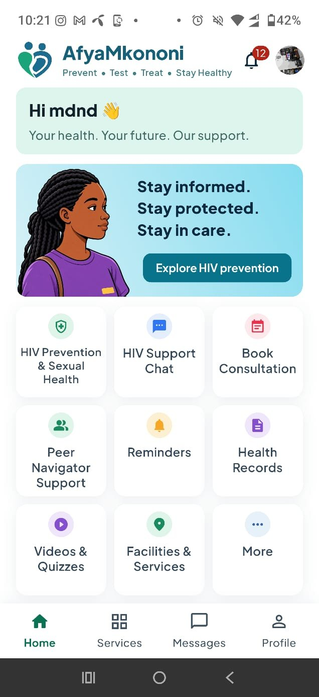</a> | <a href="docs/screenshots/patient-prevention.jpg">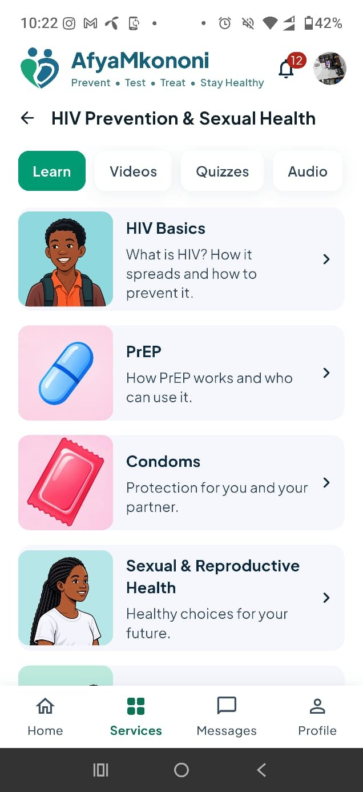</a> | <a href="docs/screenshots/patient-find-doctor.jpg">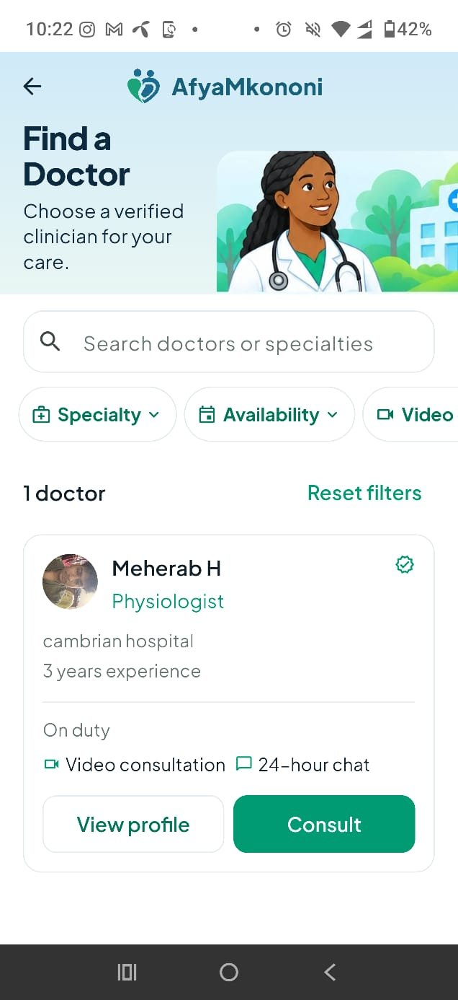</a> | <a href="docs/screenshots/patient-health-vault.jpg">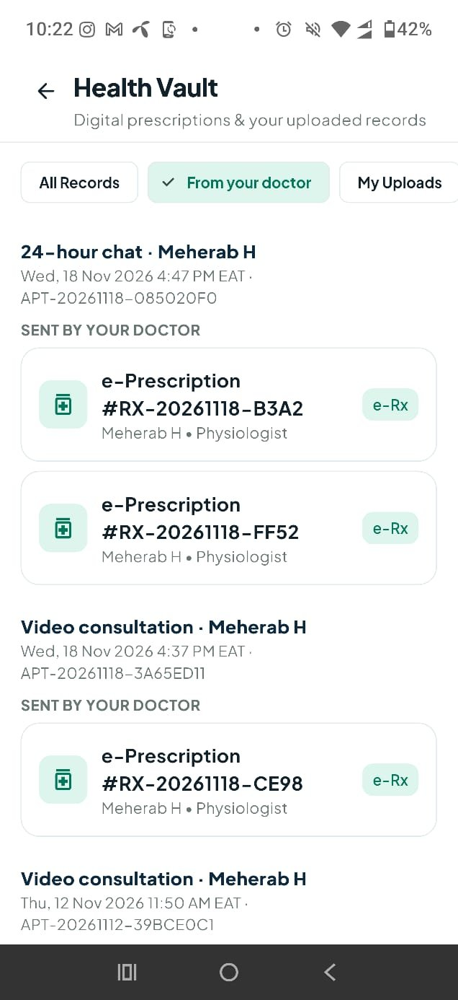</a> |

### Care app (doctors and peer navigators)

| Home dashboard | Consultation schedule | Appointments | Consultation chats |
|:---:|:---:|:---:|:---:|
| <a href="docs/screenshots/care-home.jpg">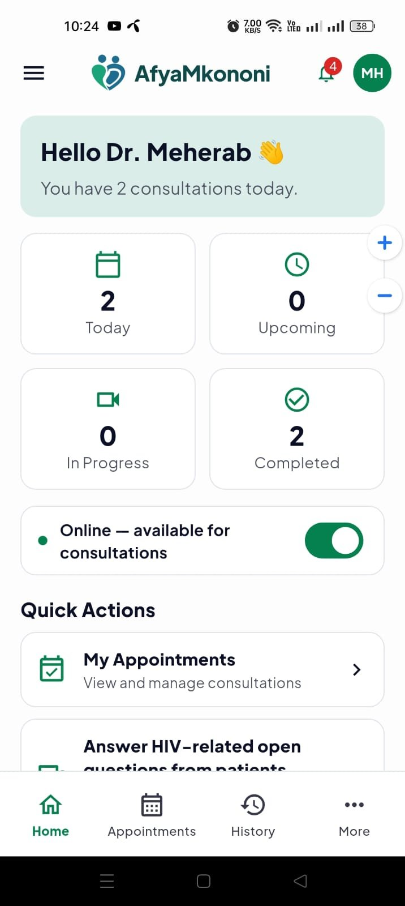</a> | <a href="docs/screenshots/care-schedule.jpg">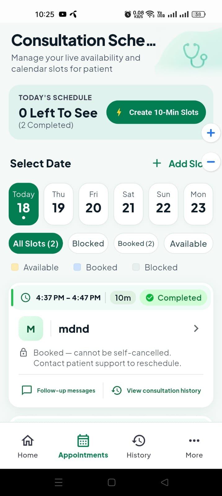</a> | <a href="docs/screenshots/care-appointments.jpg">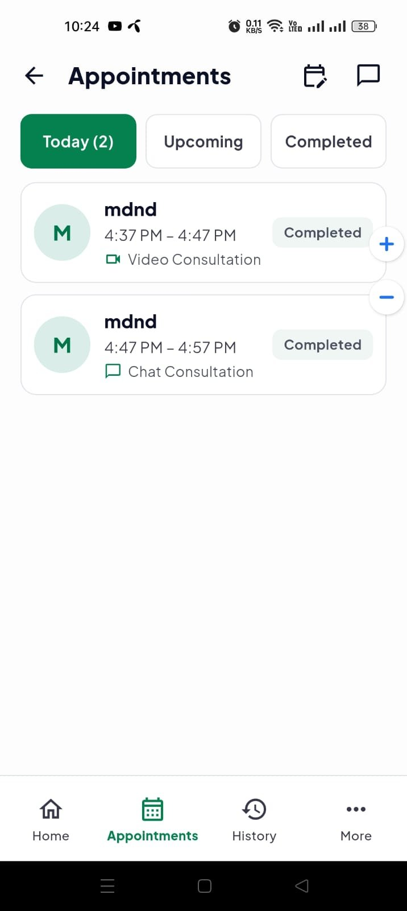</a> | <a href="docs/screenshots/care-chats.jpg">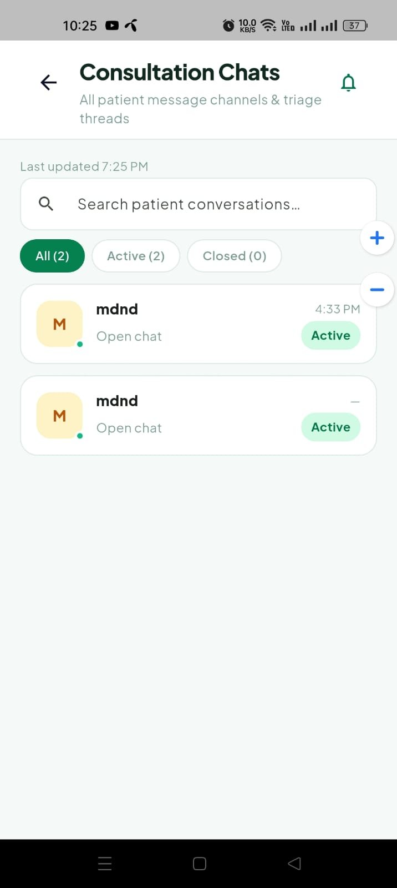</a> |

### Doctor Web and Admin Web

| Doctor Web dashboard | Doctor Web chat |
|:---:|:---:|
| <a href="docs/screenshots/doctor-web-dashboard.jpg">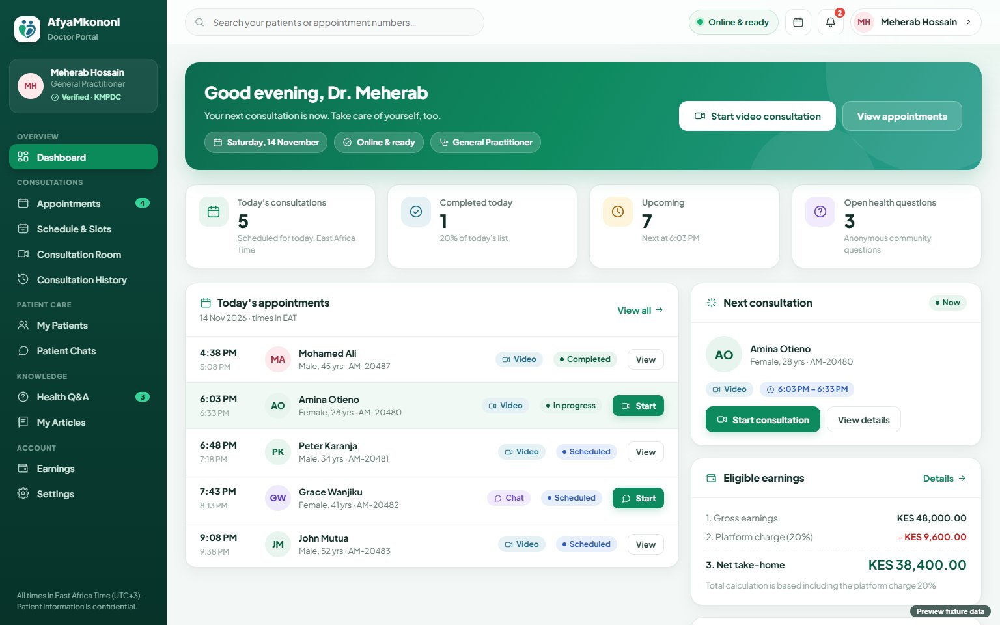</a> | <a href="docs/screenshots/doctor-web-chat.jpg">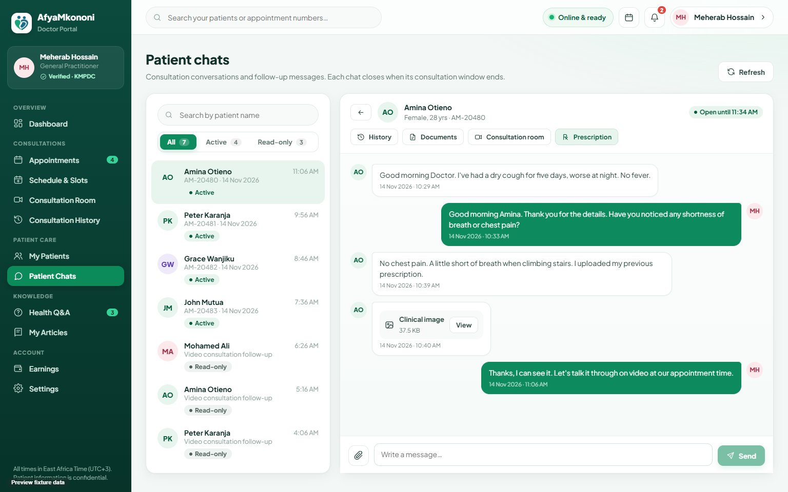</a> |
| **Admin overview** | **Admin doctor verification** |
| <a href="docs/screenshots/admin-overview.jpg">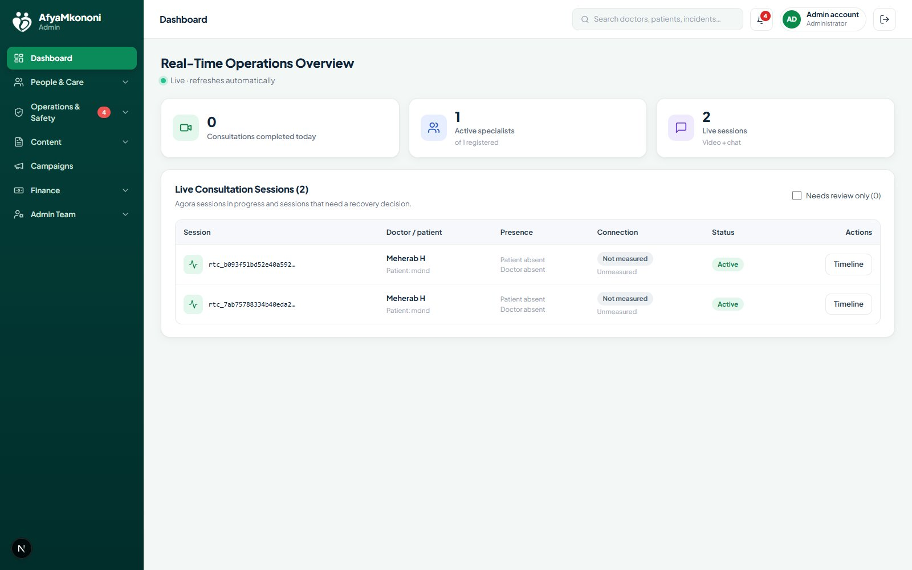</a> | <a href="docs/screenshots/admin-verification.jpg">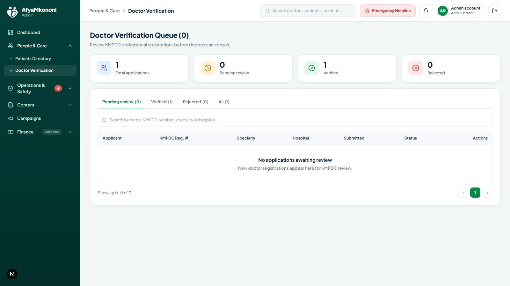</a> |

Doctor Web captures use the labelled design-preview fixtures (sample patients, not real people);
Admin captures come from the local development stack.

### Design references

| Patient app (11 panels) | Care app (11 panels) |
|---|---|
| 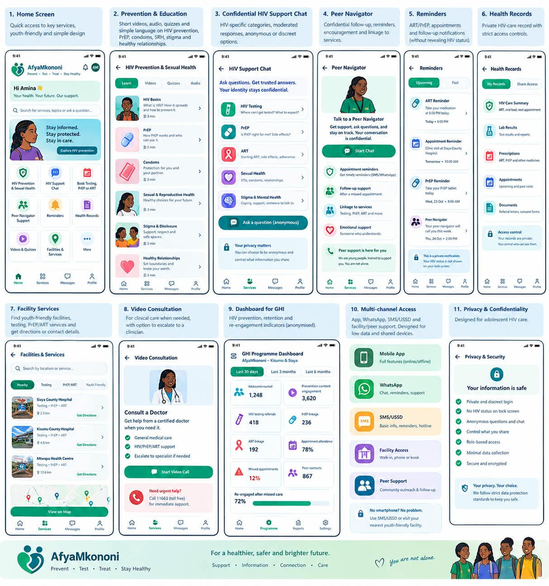 | 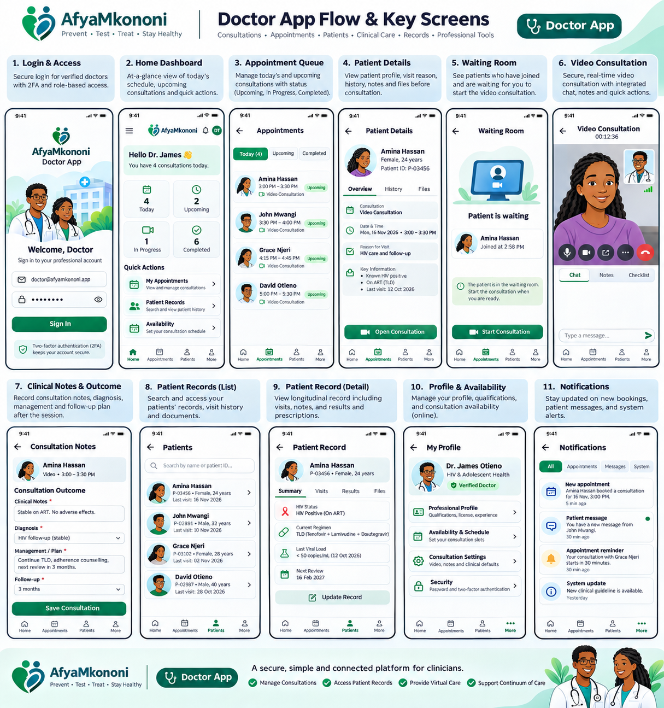 |

Admin and Doctor Web boards: [`docs/design/admin`](docs/design/admin), [`docs/design/doctor-web`](docs/design/doctor-web).

## Security, privacy and business rules

- Passwords hashed with Argon2id; no secrets in source or client apps; the Agora App Certificate exists only on the server.
- No protected health information in logs or push payloads; medical images and prescriptions are never written to generic caches.
- Every schema change ships with a down-migration.
- No star ratings or reviews; doctor earnings always shown as gross, 20 % platform charge and net.
- Consultations can complete without a prescription (with Rx, no Rx, referred, escalated).
- Payments are currently deferred; bookings confirm without a payment gateway.

The full rules are in [`docs/SYSTEM_POLICY.md`](docs/SYSTEM_POLICY.md); the current security posture is in
[`docs/assurance/SECURITY_STATUS.md`](docs/assurance/SECURITY_STATUS.md). Report suspected
vulnerabilities privately to the repository owner, not in a public issue.

## Performance

Measured on a 4 vCPU / 8 GB stack with 10,000 synthetic patients: **250 requests/s sustained at
p95 23 ms**, a 65-minute soak with zero server errors, and controlled load shedding with
`Retry-After` under a 5× spike. Method, evidence and recommendations:
[`docs/assurance/PERFORMANCE_REPORT.md`](docs/assurance/PERFORMANCE_REPORT.md).

## Documentation map

| Topic | Start here |
|---|---|
| Product and domain | [Business logic](BUSINESS_LOGIC.md), [domain model](docs/DOMAIN_MODEL.md), [user flows](docs/USER_FLOWS.md) |
| API and data | [API spec](docs/API_SPEC.md), [database schema](docs/DATABASE_SCHEMA.md), [data flow](docs/DATA_FLOW.md) |
| Security | [Auth and security](docs/AUTH_SECURITY.md), [security status](docs/assurance/SECURITY_STATUS.md) |
| Apps | [Flutter architecture](docs/FLUTTER_ARCHITECTURE.md), [patient UI](docs/patient-ui), [doctor UI](docs/doctor-ui), [Doctor Web UI](docs/doctor-web-ui), [Admin UI](docs/admin-ui) |
| Operations | [Operator runbook](docs/deployment/AZURE_VM_OPERATOR_RUNBOOK.md), [incident response](docs/INCIDENT_RESPONSE_RUNBOOK.md), [FCM](docs/FCM_SETUP.md), [Azure Blob](docs/AZURE_BLOB_SETUP.md) |
| Quality | [Testing strategy](docs/TESTING_STRATEGY.md), [acceptance criteria](docs/ACCEPTANCE_CRITERIA.md), [assurance pack](docs/assurance/README.md) |
| Decisions | [Architecture decision records](docs/ADR), [open questions](docs/OPEN_QUESTIONS.md) |

## Ownership

Repository owner and sole maintainer: **Meherab Hossain** ([@MeherabHS](https://github.com/MeherabHS)).
AfyaMkononi is operated in Kenya by Global Health Initiatives (GHI), with Research and Management
Consultants Ltd. (RMCL) as technology partner. No open-source licence is granted; all rights are
reserved.
