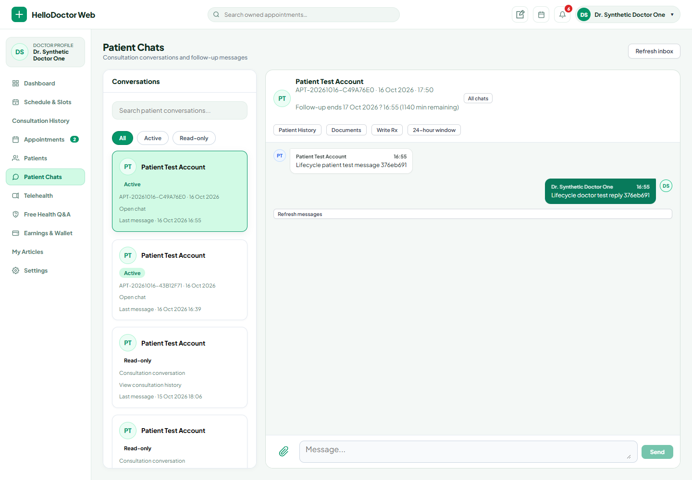
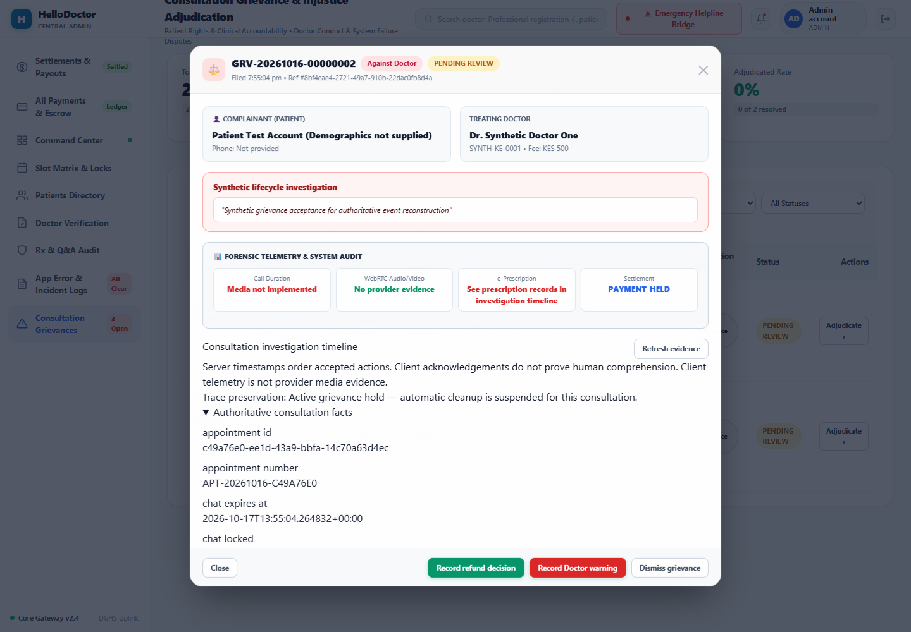

# API traffic, cache and polling correction

Implementation started 2026-10-16; final acceptance completed 2026-10-17 (Asia/Dhaka). This pass builds on the completed consultation lifecycle milestone. Physical-device measurement is unavailable: ADB reports no device; the user authorized continuing without device verification. Video/Agora remains deferred.

## Changes

- Both Flutter apps share a screen-owned refresh coordinator. Covered routes and paused/backgrounded apps stop their screen timers; route return, resume and relevant reconnect trigger one reconciliation. Equivalent in-flight GETs share one transport within an authenticated account generation. Finished responses are not treated as an authorization cache.
- Patient availability remains a fresh server read on relevant entry/resume/reconnect, with a 30-second visible-screen refresh. Other screens do not poll its slots. Existing database wall-time filters and booking revalidation remain authoritative.
- The existing appointment-status waiting page uses the same route/background coordinator. Its 15-second status cadence and terminal-state behavior are preserved; no RTC/media/join behavior was implemented or changed.
- Doctor Queue reconciles Queue/duty only, rather than reloading wallet, profile, all slots, Q&A and all chats every tick. Queue cache hydration no longer overwrites unrelated fresh state. The global reconnect handler no longer reloads every feature.
- Doctor Schedule requests its selected Nairobi calendar day using the additive `day=YYYY-MM-DD` query. Changing days fetches that day; repeated requests coalesce by day. Previous days can remain in memory for presentation. Historical database rows remain untouched. The legacy no-day API remains compatible.
- Chat message initial load remains latest 50 with older cursor pages. Polls fetch after the newest known `(timestamp,id)` cursor; catch-up is bounded to four 50-row pages per reconciliation. Existing 200-message and sender/history regressions remain intact. Historical locked conversations do not need aggressive polling; authorized manual reads remain available.
- Chat consultation lists use on-demand 100-row pages. A refresh revisits only the loaded page depth, not every historical page. Older pages require an explicit action. Patient Past and Doctor Closed views do not poll continuously.
- Global mobile Notification Center synchronization is once per foreground minute: one after-cursor delta plus unread count during a quiet tick. Catch-up is bounded to four 25-row delta pages. The inbox has an explicit older-page action. The default Cubit cadence remains configurable for existing callers; both application shells explicitly choose one minute.
- Doctor Web appointments reconcile only on relevant routes. Current Queue refresh is 15 seconds while visible; Schedule uses selected-day reads; Chat uses 10-second active-thread reads; unread count uses a visible-tab 60-second cadence. Unrelated routes stop appointment and Chat polling. History automatic full refreshes were removed; entry, pagination and explicit refresh remain.
- Admin Web refresh is route-scoped (30 seconds). Doctor/Patient dossiers load only when individually opened. Existing list/overview summaries provide counts and booked-fee totals without frontend N+1 clinical dossier reads. These totals retain their existing booked-fee semantics; they are not presented as settled payment evidence.
- Admin grievance evidence uses bounded event cursor pages and record-reference pages, with loaded/total indicators and explicit access to all remaining data. A fixed server timestamp bounds traversal, so access-audit events from subsequent page reads do not cause endless growth. Event-only pages omit record collections; reference-only pages omit event collections. Replacement-slot reads depend on the investigation snapshot, not each additional evidence page.

## Security and trace boundaries

Encrypted persisted caches remain in place for existing Doctor state and Patient appointments/profile data. New in-flight coalescing retains no completed-response cache. Account generation participates in the key; logout/account changes cannot join old requests and late old-account responses are rejected.

Booking, payment, messages, protected documents/Rx and administrative mutations still require backend authentication, ABAC/BOLA, RLS and state/time checks. Client connectivity/expiry checks are UX controls. The server remains authoritative.

Message/notification/trace creation continues inside the existing server transaction. No client loop polls the consultation trace API. Only truthful client-open/read/recovery acknowledgements require their existing lightweight requests. No clinical body is duplicated into the trace or notification.

## Traffic budgets

These are configured quiet-screen budgets, excluding initial entry, explicit actions, a new-message read acknowledgement, catch-up pages, incident reporting and foreground transitions. Actual browser windows and simulated mobile observations are recorded separately; this is not a 1,200-user load test.

| Screen | Periodic feature traffic |
|---|---|
| Patient Home | 2 notification reads per foreground minute; no Chat/slot/history polling |
| Doctor Queue | Queue + duty each 30 seconds, plus 2 notification reads per minute |
| Patient/Doctor open active Chat | One message delta per 10 seconds, plus global notification checks |
| Closed/covered mobile Chat | Zero Chat timer reads |
| Patient visible availability | One relevant availability refresh per 30 seconds |
| Doctor visible Schedule | Selected-day slot pages per 30 seconds |
| Mobile background | Zero foreground screen/notification timer requests; existing OS-managed best-effort background worker is separate |
| Doctor Web Queue | Current appointments per 15 seconds; unread count per visible minute |
| Doctor Web active Chat | Message delta per 10 seconds; unread count per visible minute |
| Admin grievances | Grievance list per visible 30 seconds; evidence pages only on entry/action |

## Automated evidence

Frozen independent baseline: `docs/audit_evidence/api_traffic/baseline.json`, 770 previously observed passing tests. No historical baseline/tag was modified.

| Suite | Before | Final |
|---|---:|---:|
| Rust library | 53 | 53 |
| Backend integration | 235 | 239 |
| Patient Flutter | 205 | 214 |
| Doctor Flutter | 208 | 217 |
| Doctor Web | 53 | 59 |
| Admin Web | 16 | 20 |

Mobile format/analyze/full tests and both release builds passed. Web lint/typecheck/tests/production builds passed (Admin lint has pre-existing warnings; no errors). Backend format, strict offline Clippy, all 53 library tests and all 239 serialized integration tests passed on the final source (native exit 0; 0 failures, 0 ignored, 0 filtered out). The complete total is 802 passing tests, 32 additions over the frozen 770-test baseline.

Added regressions cover in-flight GET transport counts, distinct queries/accounts, failed read retry, late account responses, covered-route/background suppression, reconnect/timer coalescing, bounded notification catch-up, older inbox pages, foreground-minute cadence, selected-day API boundaries, stable owner-scoped cursors, complete bounded Admin timeline/reference traversal and aggregate-summary equivalence.

Real browser acceptance found a BFF wiring omission: the selected-day Schedule query was not in the proxy allowlist. Production now accepts `day` only on `doctor/slots`; new exact assertions retain rejection of privileged query fields and day on unrelated endpoints. Browser acceptance requires HTTP success as well as bounded request counts. The initial harness direct-request path was replaced by the same-origin browser fetch so HttpOnly/Secure cookie behavior is exercised normally. Failed attempts remain saved.

An existing Schedule test caught a self-await deadlock in the new coalescing-map cleanup. Production cleanup was corrected; its original assertions and 30-second timeout were preserved.

`test_integrity_audit.json` compares complete parsed existing assertions against the frozen snapshot, and saves per-file test diffs. Existing test files modified:

- `services/backend/tests/api_tests.rs`: four new tests appended.
- `apps/mobile/test/doctor_cubit_test.dart`, `doctor_widgets_test.dart`: fakes accept optional day.
- `apps/mobile/test/notification_cubit_test.dart`, `apps/mobile_patient/test/notification_cubit_test.dart`: fakes implement the additive delta protocol.
- `apps/mobile_patient/test/chat_cubit_test.dart`: fake implements newer-message reads.
- `apps/mobile/test/consultation_pagination_test.dart`: new first-page and has-more assertions, followed by explicit Load More, then every original ordering/identity/page assertion unchanged.

EXISTING_TESTS_DELETED = 0
EXISTING_ASSERTIONS_DELETED = 0
TEST_ASSERTIONS_WEAKENED = 0
TEST_SKIP_OR_IGNORE_ADDED = 0
TEST_RUNNER_FAILURES_SWALLOWED = 0
EXISTING_ASSERTIONS_INTENTIONALLY_CHANGED = 0

Failed/interrupted development attempts remain recorded as failed/incomplete evidence. Final pass claims require observed native exit codes. Test runners, concurrency and historical security expectations were not weakened.

## Browser/device evidence

Real Edge/BFF/backend request-count verification: PASS, native exit 0, no page errors and no failed protected HTTP responses. These are actual wall-clock windows, excluding entry/settling requests; no timer acceleration was used.

| Observed Web state | Window | Actual requests |
|---|---:|---|
| Doctor Wallet idle | 35 seconds | 0 |
| Doctor Queue idle | 35 seconds | 2 current-appointment reads + 1 unread-count read |
| Doctor selected-date Schedule | 35 seconds | 2 selected-day reads; no appointment scan |
| Doctor active Chat | 32 seconds | 3 cursor message reads |
| Doctor Chat with controlled DOM visibility hidden | 22 seconds | 0 |
| Doctor Chat with browser network offline | 22 seconds | 0 |
| Doctor Chat closed, Wallet active | 22 seconds | 0 Chat reads (0 total in this sample) |
| Admin grievance list idle | 35 seconds | 1 grievance-list read; no Doctor/Patient dossiers, finance or slot reads |
| Admin with controlled DOM visibility hidden | 35 seconds | 0 |

The final browser run authenticated through both real BFFs, verified selected-day HTTP 200, opened persisted Chat and rendered the Admin grievance timeline. Screenshots were captured and visually inspected. Complete safe counts/paths and timing are in `docs/audit_evidence/api_traffic/live_web_traffic.json`.

Earlier failed browser attempts are retained: direct harness request/cookie context, cold-start readiness, and a stale Admin asset manifest after rebuilding. The BFF day-filter omission discovered during acceptance was fixed in production with a new restriction-preserving regression. Both servers were restarted from their final builds; the complete final browser run passed without removing assertions or ignoring errors.

Mobile traffic tests use controlled Flutter lifecycle/navigation and real ApiClient transport interceptions; they do not claim a connected handset or external provider. Browser hidden checks explicitly report whether visibility was controlled through the DOM. Offline checks use the actual browser network switch. No external push was introduced.

Updated signed development APKs:

- `releases/hellodoctor-doctor-arm64-api-traffic-20261016.apk` ? 1.0.1+8.
- `releases/hellodoctor-patient-arm64-api-traffic-20261016.apk` ? 1.0.1+7.

Both target the existing LAN development backend, allow development HTTP/OTP explicitly and are not production deployment artifacts. SHA-256, sizes and signature results are in `docs/audit_evidence/api_traffic/release_artifacts.json`. Neither was installed on a device during this pass.

## Status

PATIENT_API_POLLING_BOUNDED = AUTOMATED_VERIFIED
DOCTOR_API_POLLING_BOUNDED = AUTOMATED_AND_REAL_LOCAL_WEB_VERIFIED
BACKGROUND_API_STORM_ABSENT = AUTOMATED_TIMER_AND_CONTROLLED_BROWSER_VISIBILITY_VERIFIED
CHAT_POLLING_ROUTE_SCOPED = AUTOMATED_VERIFIED
AVAILABILITY_POLLING_ROUTE_SCOPED = AUTOMATED_VERIFIED
DUPLICATE_INFLIGHT_FETCH_COALESCED = AUTOMATED_VERIFIED
TRACE_EVENTS_SERVER_GENERATED_WHERE_POSSIBLE = PRESERVED
CACHE_NOT_USED_AS_AUTHORIZATION = PRESERVED

PHYSICAL_DEVICE_API_REQUEST_COUNTS_VERIFIED = NO
REAL_EXTERNAL_PAYMENT_PROVIDER_VERIFIED = NO
REAL_AZURE_BLOB_VERIFIED = NO
VIDEO_AGORA_IMPLEMENTATION = DEFERRED
RTC_MEDIA_VERIFIED = NO

Remaining boundaries: background local delivery remains OS-dependent; notification unread count is a separate bounded read; previously opened metadata may render from encrypted cache while protected operations reauthorize; offset-based consultation-list/reference pages may shift if records change and are refreshed, while Chat and notification cursor paging uses stable tuples. The Admin timeline snapshot is time-bounded rather than a retained database transaction across requests. Physical OS/network/resource behavior still needs handset acceptance.

## Completion ledger

All automated gates passed: 53 Rust library + 239 backend integration + 214 Patient Flutter + 217 Doctor Flutter + 59 Doctor Web + 20 Admin Web = **802 tests**. Strict offline Clippy, Flutter analysis/format, Web typechecks/lint/builds, APK signatures/package versions, unchanged security tag and final backend schema readiness were observed. Admin lint retains 9 warnings and 0 errors.

The live backend is restored and healthy: source, binary and database all report migration `20261106000006`. Doctor Web and Admin Web are running their final production builds locally. No new migration or backend/RLS architecture change was needed for this traffic correction.

The current correction is complete for automated and local Web acceptance. Physical-device API counts, Android OS delivery/resource behavior and installation acceptance remain explicitly unverified until a handset is available. External payment, Azure and RTC remain outside these claims.
