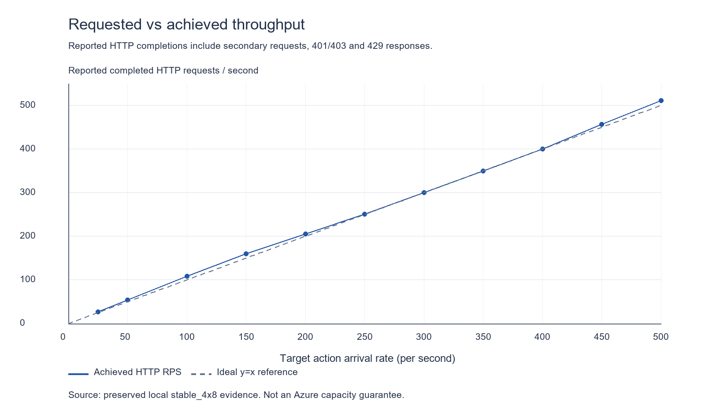
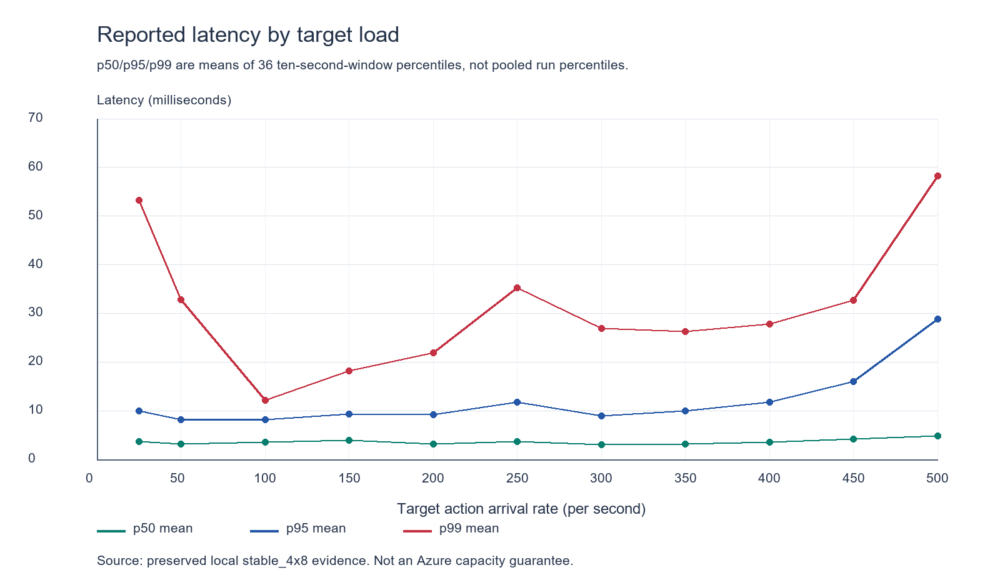
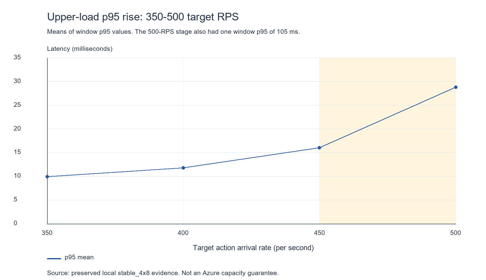
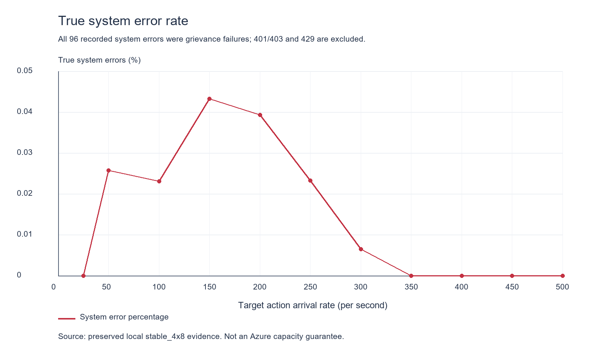
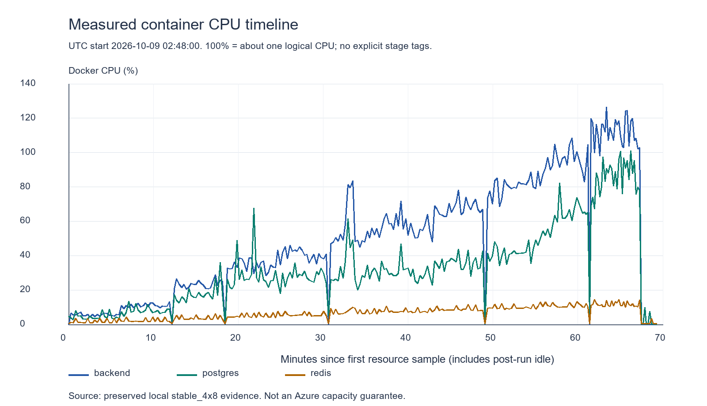
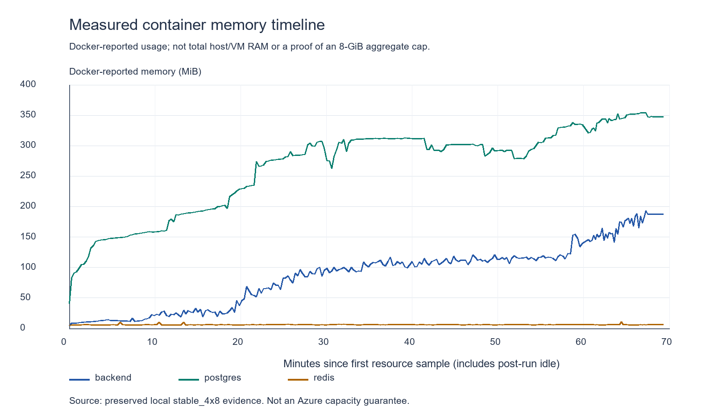

# PRE-PATIENT stable 4-vCPU / 8-GB engineering evidence report

**Consolidated:** 2026-10-09. **Run:** local Windows/WSL2/Docker; synthetic users only; no real PHI; no Patient Flutter app. **Scope:** reporting and read-only evidence inspection, not a new benchmark or application patch.

The supplied authoritative 25-500 target-RPS ladder is reproduced exactly below and independently reconciled against its saved logs. Its capacity objective passed for the recorded mixed HTTP workload: no throughput collapse or definitive capacity knee was demonstrated through the 500-RPS ceiling. Strict certification of the entire stable-four-CPU/8-GB envelope remains **PARTIAL**, because historical backend-container identity, an aggregate 8-GB limit and post-fix regression evidence are incomplete. These qualifications do not erase the measured ladder or the confirmed application defect.

## 1. Authoritative measured results

| Target RPS | Achieved RPS | p50 ms | p95 ms | p99 ms | True system error rate |
| --- | --- | --- | --- | --- | --- |
| 25 | 27.1 | 3.7 | 9.9 | 53.2 | 0.0000% |
| 50 | 54.1 | 3.2 | 8.2 | 32.8 | 0.0257% |
| 100 | 108.1 | 3.5 | 8.2 | 12.2 | 0.0231% |
| 150 | 160.2 | 3.9 | 9.3 | 18.2 | 0.0433% |
| 200 | 205.1 | 3.2 | 9.2 | 21.9 | 0.0393% |
| 250 | 250.6 | 3.6 | 11.7 | 35.2 | 0.0233% |
| 300 | 300.0 | 3.0 | 8.9 | 26.9 | 0.0065% |
| 350 | 350.0 | 3.2 | 9.9 | 26.3 | 0.0000% |
| 400 | 400.2 | 3.5 | 11.8 | 27.8 | 0.0000% |
| 450 | 456.7 | 4.2 | 16.0 | 32.7 | 0.0000% |
| 500 | 511.3 | 4.8 | 28.8 | 58.2 | 0.0000% |

Source: [preserved parsed summary](audit_evidence/pre_patient_benchmark_4x8/stable_4x8/parsed_summary.json); individual raw stages: [25](audit_evidence/pre_patient_benchmark_4x8/stable_4x8/rps25.txt), [50](audit_evidence/pre_patient_benchmark_4x8/stable_4x8/rps50.txt), [100](audit_evidence/pre_patient_benchmark_4x8/stable_4x8/rps100.txt), [150](audit_evidence/pre_patient_benchmark_4x8/stable_4x8/rps150.txt), [200](audit_evidence/pre_patient_benchmark_4x8/stable_4x8/rps200.txt), [250](audit_evidence/pre_patient_benchmark_4x8/stable_4x8/rps250.txt), [300](audit_evidence/pre_patient_benchmark_4x8/stable_4x8/rps300.txt), [350](audit_evidence/pre_patient_benchmark_4x8/stable_4x8/rps350.txt), [400](audit_evidence/pre_patient_benchmark_4x8/stable_4x8/rps400.txt), [450](audit_evidence/pre_patient_benchmark_4x8/stable_4x8/rps450.txt), [500](audit_evidence/pre_patient_benchmark_4x8/stable_4x8/rps500.txt). [Exact chart/table CSV](audit_evidence/pre_patient_stable_4v8/authoritative_results.csv). No older series was substituted.

**Metric definition matters.** The supplied p50/p95/p99 values are the arithmetic means of the 36 ten-second-window percentiles printed in each 360-second stage. Recomputing those means reproduces every supplied value. They are **not pooled percentiles across every request in the stage**; the individual request samples needed to recompute those pooled percentiles are not retained here. Endpoint tables contain separate per-endpoint percentiles. Charts use the exact supplied values and label this distinction.

## 2. Primary performance finding

Across all eleven stages, reported achieved HTTP throughput tracked or exceeded requested action arrivals. At target 500 RPS it was **511.3 RPS**, with reported p50 **4.8 ms**, p95 **28.8 ms**, p99 **58.2 ms**, and **0.0000%** true system errors. At least the tested load was sustained under this benchmark environment and its observed response mix.

**NO CAPACITY KNEE WAS DEMONSTRATED AT OR BELOW THE 500-RPS TEST CEILING FOR THIS PARTICULAR LOCAL STABLE-4-vCPU / 8-GB BENCHMARK PROFILE.**

This does not establish a maximum of 511 RPS, a ceiling above 500, or an Azure guarantee. The highest stage was the end of this series, not a measured failure boundary.



## 3. Harness semantics and admitted-work boundary

The inspected [capacity harness](../services/backend/examples/capacity_test.rs) uses an open-loop Tokio interval, spawning work independently of previous response completion. Missed ticks use Burst catch-up. Secondary requests, notably a payment-confirmation callback after a successful booking, are counted separately. Therefore target RPS is an **action dispatch rate**, whereas achieved RPS is **recorded HTTP samples / configured duration**. At 500: 180,001 dispatched actions yielded 184,073 HTTP samples; the 4,072 extra samples match the 4,072 webhook confirmations. Exceeding y=x is partly this accounting difference, not unexplained extra business capacity.

The code awaits spawned work before collecting final samples but divides by the configured 360 seconds rather than an independently recorded wall-clock including drain. Thus achieved RPS is the harness's reported rate, not a separately measured ingress/completion-meter rate. No drain duration or queue depth is archived. This prevents claiming that no queue existed at any moment.

Outcome classification is 2xx = success; 401/403 = authorization rejection; 429 = rate limited; 5xx or status 0/transport failure = true system error; other statuses = business rejection. The denominator includes all outcomes. A zero system-error rate does not mean every attempted business action succeeded. These are the actual recorded counts:

| Target | Dispatched actions | HTTP samples | 2xx | 401/403 | 429 | System errors |
| --- | --- | --- | --- | --- | --- | --- |
| 25 | 9,001 | 9,757 | 9,285 | 472 | 0 | 0 |
| 50 | 18,001 | 19,461 | 18,170 | 1,281 | 5 | 5 |
| 100 | 36,001 | 38,908 | 35,752 | 3,073 | 74 | 9 |
| 150 | 54,001 | 57,674 | 51,732 | 4,967 | 950 | 25 |
| 200 | 72,000 | 73,831 | 63,801 | 5,487 | 4,514 | 29 |
| 250 | 89,999 | 90,224 | 78,354 | 3,831 | 8,018 | 21 |
| 300 | 108,001 | 108,007 | 94,444 | 3,936 | 9,620 | 7 |
| 350 | 126,000 | 126,001 | 110,696 | 4,507 | 10,798 | 0 |
| 400 | 144,000 | 144,071 | 127,212 | 5,300 | 11,559 | 0 |
| 450 | 162,000 | 164,405 | 145,046 | 9,538 | 9,821 | 0 |
| 500 | 180,001 | 184,073 | 160,930 | 14,526 | 8,617 | 0 |

At 500, **160,930 / 184,073 = 87.427%** of HTTP samples succeeded, about **447.0 successful HTTP requests/s** on the same denominator. That is neither 500 successful bookings/s nor a human-user count. All 8,073 RTC-token attempts were authorization-rejected; Admin telemetry had 717 successes and 6,453 authorization rejections; every grievance attempt was rate-limited. Consequently this is not a success-only clinical/media/provider-capacity benchmark. No additional status/body detail was saved to establish the exact cause of each RTC/Admin denial; they are not automatically labeled intended negative tests.

The mix contains directory/slot/wallet/Admin reads, booking, synthetic signed webhooks, chat, grievances, RTC-token requests and telemetry. The source has identity-state/booking limits and fallback reads, so its effective endpoint proportions change as the ladder progresses. Reusing identities and Redis budgets changes admitted write traffic: this is not eleven independent, fresh, identical business-workload samples. Compose raises only the benchmark's global single-source-IP allowance to 100,000/min; per-user booking/grievance controls still operate. This override is local and is not a public-deployment setting.

## 4. Latency interpretation

The p95 mean stays within 8.2-11.8 ms through target 400, then rises to 16.0 at 450 and 28.8 at 500. From 400 to 500 it increases **2.44x**; from 450 to 500, **1.80x**. p50 rises from 3.5 at 400 to 4.8 at 500. p99 rises from 27.8 at 400 to 32.7 at 450 and 58.2 at 500, **2.09x** over 400-500. Lower-stage p99 is not monotonic: 53.2 at 25 falls to 12.2 at 100, and 250's 35.2 falls to 26.9 at 300. Warm-up, changing endpoint mix and limits are potential influences, not isolated causal findings.

The upper-end rise is real and must not be called a flat curve. It is an early pressure signal, not the seconds-long progressive collapse seen in the older constrained profile. The reported stage summaries remain in tens of milliseconds. The 500-stage raw windows also expose a **105-ms p95 and 136-ms p99** in seconds 300-310, followed by lower values; the maximum endpoint latency was 353 ms. Admin telemetry's endpoint p95/p99 were 180/228 ms. Thus the stage averages do not mean every request or window stayed below 100 ms.

The last stage's reported 10-second rates decrease from 519.3 initially to 501.4 at the end, still above target. Extra booking callbacks reduce with depleted booking allowance, so this drift cannot by itself be attributed to saturation. No progressive runaway latency sequence or throughput collapse is demonstrated, but a long production soak and queue instrumentation were not performed.





## 5. Confirmed grievance concurrency defect

**Classification: REAL APPLICATION CONCURRENCY / IDENTIFIER-GENERATION DEFECT.**

The historical implementation in `GrievanceService::submit_grievance` generated:

```rust
let grv_id = Uuid::new_v4();
let grv_num = format!("GRV-{}-{}", Utc::now().format("%Y%m%d"),
    grv_id.to_string()[0..4].to_uppercase());
```

That retains only four hexadecimal suffix characters: **16 bits / 65,536 possibilities per date**. Independent requests, including overlapping concurrent requests, can choose the same suffix. This is a finite-namespace collision, not a missing lock that only appears when requests execute simultaneously; accumulated same-day submissions make collisions possible even sequentially. The original migration defines `grievance_number VARCHAR(50) NOT NULL UNIQUE`, correctly preventing duplicate rows. The application propagated the database constraint error as HTTP 500.

Evidence chain:

1. [Original schema](../services/backend/migrations/20261001000001_initial_schema.up.sql), grievance table: number is NOT NULL UNIQUE. Current PostgreSQL inspection confirms `UNIQUE (grievance_number)` and FORCE RLS.
2. [Historical source excerpt](audit_evidence/pre_patient_stable_4v8/legacy_grievance_service_excerpt.txt) extracted read-only from Git HEAD proves the four-character generation. It is historical source, not a claim that HEAD equals the dirty benchmark binary.
3. [Saved PostgreSQL constraint errors](audit_evidence/pre_patient_stable_4v8/postgres_constraint_log_excerpt.txt) contain **96** occurrences of `duplicate key value violates unique constraint "grievance_reports_grievance_number_key"`, from 02:56:24 to 03:29:21 UTC on 2026-10-09.
4. [System error evidence](audit_evidence/pre_patient_stable_4v8/system_error_evidence.json) has one deduplicated DATABASE / `AppError::Database` / `DB_QUERY_FAILED` record, HTTP 500, **occurrence_count = 96**, with the same constraint message and source location `src/services/grievance_service.rs:52`. Its timestamps agree. The endpoint field is null; a per-request trace-ID join was not available.
5. The ladder has **96 total system errors**, all in `POST grievance`, with no other endpoint system errors. The stage counts and timestamps reconcile to the aggregate PostgreSQL/error-service evidence.

This is not CPU saturation, Azure behavior, a Docker artifact, a harness error or database corruption. The database maintained its unique constraint; failed submissions received errors rather than duplicate references being committed. No new full financial/clinical integrity audit was run for this report, so this narrow proof does not become a blanket zero-corruption certification.

## 6. Non-zero early errors and why later zero is not a fix proof

| Target | Grievance attempts | Grievance 2xx | Grievance 429 | Grievance system errors |
| --- | --- | --- | --- | --- |
| 25 | 176 | 176 | 0 | 0 |
| 50 | 385 | 375 | 5 | 5 |
| 100 | 709 | 642 | 58 | 9 |
| 150 | 1,088 | 784 | 279 | 25 |
| 200 | 1,504 | 666 | 809 | 29 |
| 250 | 1,833 | 341 | 1,471 | 21 |
| 300 | 2,163 | 153 | 2,003 | 7 |
| 350 | 2,478 | 33 | 2,445 | 0 |
| 400 | 2,920 | 3 | 2,917 | 0 |
| 450 | 3,303 | 3 | 3,300 | 0 |
| 500 | 3,621 | 0 | 3,621 | 0 |

The non-zero 50/100/150/200/250/300 rates correspond to **5/9/25/29/21/7 grievance errors**, totaling 96. These are application correctness failures, not demonstrated capacity failures. No second system-error cause appears in the endpoint tables or the available benchmark system-error record. Auth rejections and rate limits remain separate and are not silently removed.

Later zero-error stages progressively stop exercising successful grievance insertion: 350 has 33 successes, 400 and 450 have three each, and 500 has **zero successes and 3,621 rate limits**. The fix migration was installed only at **04:05:44 UTC**, after the final stage log at **03:55:26 UTC**. The upper-stage zeros therefore cannot establish that the grievance fix worked; they preceded it and largely reflect blocked grievance attempts. Rate-limit-budget exhaustion is consistent with the source and counts, but no historical Redis counter dump proves each individual rejection's cause.



## 7. Fix status: what is proven and what remains open

Current [service](../services/backend/src/services/grievance_service.rs) no longer creates the human reference in Rust. It uses an empty placeholder, then assigns the reference returned by [repository INSERT ... RETURNING](../services/backend/src/repository/grievance_repo.rs). INSERT omits `grievance_number`, invoking the database DEFAULT. New migration [20261028000001](../services/backend/migrations/20261028000001_grievance_number_sequence.up.sql) creates a non-cycling PostgreSQL sequence, grants API-role USAGE, and sets:

```sql
'GRV-' || to_char(now(), 'YYYYMMDD') || '-' ||
lpad(nextval('grievance_number_seq')::text, 8, '0')
```

Atomic `nextval` allocations replace the random 16-bit namespace; normal transaction rollbacks can leave acceptable gaps. Historical grievance numbers are not rewritten. [Post-benchmark DB inspection](audit_evidence/pre_patient_stable_4v8/current_database_inspection.json), [fix inspection](audit_evidence/pre_patient_stable_4v8/fix_scope_inspection.json) and [current readiness response](audit_evidence/pre_patient_stable_4v8/current_health.json) prove the migration is applied and source/latest binary/benchmark DB now agree at **20261028000001**, after the ladder. Its stored SHA-384 checksum is recorded for audit. This is a **post-run state**, not a retroactive identity for every stage.

**Important remaining formatter defect:** `lpad(text, 8, '0')` truncates inputs longer than eight characters. A read-only PostgreSQL expression check returned `10000000` for **both** sequence values `100000000` and `100000001`. Therefore unique sequence allocations do not imply eternally unique formatted references in this implementation. The sequence has a BIGINT maximum and no matching eight-digit bound. Beyond 99,999,999, adjacent same-day allocations can collide again. This is a real boundary issue in the present fix; no application/migration code was changed for this reporting task. Preserve the full sequence digits or impose an explicit safe namespace limit in a separately authorized correction.

### Concurrent grievance-reference verification - supplemental evidence

Concurrent grievance-reference verification. The previous grievance identifier implementation was replaced with a PostgreSQL sequence-backed reference generator. A direct database concurrency test was executed using PostgreSQL 16 pgbench with 50 simultaneous clients, 8 worker threads and 10 transactions per client, producing 500 attempted inserts. All 500 transactions completed successfully with zero failed transactions. Average transaction latency was 17.777 ms. A post-test uniqueness query across the accumulated verification dataset returned 1,200 grievance rows and 1,200 distinct grievance_number values, confirming zero collisions. This test deliberately bypassed HTTP rate limiting to isolate the database mechanism that caused the original race condition; it therefore verifies database-level concurrency safety rather than end-to-end API throughput.

**Provenance and scope:** These execution figures were supplied by the user after the initial report. [Supplemental evidence record](audit_evidence/pre_patient_stable_4v8/concurrent_grievance_verification_addendum.json) preserves the statement, parameters and subsequent source inspection. Raw pgbench stdout and the exact uniqueness-query SQL were not supplied or found in the searched saved artifacts, so the run is recorded as user-reported rather than rerun or independently reproduced here. The earlier read-only snapshot corroborates 1,200 sequence-format rows; it also contains 3,354 legacy-format rows, so the verification dataset must not be confused with the entire historical grievance table. The 500-attempt test and the accumulated 1,200-row uniqueness query are separate measurements.

A subsequent source inspection also finds the permanent `test_grievance_number_unique_under_concurrent_submission` test in [api_tests.rs](../services/backend/tests/api_tests.rs). It starts 40 concurrent service submissions and requires every call to succeed with a distinct reference; it deliberately avoids the HTTP grievance limiter. This supersedes the initial source snapshot's absence-of-test finding. The test was not executed for this documentation addendum. The later project progress entry reports clean fmt/clippy, 50/50 library and 143/143 API tests; matching full-run stdout is not attached here. The original 142-test baseline remains the pre-benchmark record.

The supplied pgbench result supports database-level concurrency safety for the exercised sequence range. It does not establish end-to-end API performance, remove the eight-digit formatting boundary, or turn pre-fix zero-error ladder stages into post-fix tests.

| Defect milestone | Classification | Evidence boundary |
| --- | --- | --- |
| DISCOVERED | **YES** | Real HTTP errors, endpoint counts, constraint errors and system error record |
| ROOT-CAUSED | **YES** | Four-character random suffix and UNIQUE constraint |
| FIXED: original 16-bit mechanism | **REPLACEMENT PRESENT IN SOURCE AND APPLIED DB** | Database sequence DEFAULT + INSERT RETURNING; migration applied after ladder |
| FIXED: full reference uniqueness over supported sequence range | **PARTIAL / BOUNDARY CORRECTION PENDING** | Eight-digit formatter truncates larger sequence values |
| REGRESSION-VERIFIED: exercised database mechanism | **PASS - USER-REPORTED** | pgbench: 500/500 transactions, zero failures; accumulated verification dataset 1,200/1,200 distinct references |
| Permanent service concurrency test | **PRESENT; NOT RERUN FOR ADDENDUM** | 40 simultaneous service submissions; later project record reports 143/143 API, without attached execution stdout |
| Full-range formatting / end-to-end acceptance | **NOT ESTABLISHED** | Eight-digit boundary remains; direct DB test deliberately bypasses HTTP rate limiting |

`GRIEVANCE_NUMBER_CONCURRENCY_BUG_DISCOVERED` is supported. The supplied evidence adds a passing direct-database concurrency check for the exercised values. The unqualified `GRIEVANCE_NUMBER_CONCURRENCY_BUG_FIXED_AND_REGRESSION_VERIFIED` is still **not** claimed across the full supported sequence range because the formatter boundary remains.

## 8. Why this finding matters independently of hardware

The benchmark exposed a concrete application defect not caught by the earlier reported functional/unit/lint gates. Its value extends beyond an RPS chart: realistic overlap and accumulated activity reached a collision-prone namespace that small functional fixtures did not exercise. This does not prove that static analysis could never detect the defect; it proves the earlier checks had not prevented this observed failure.

The finding transfers to Ryzen desktop silicon, Azure x64, Azure ARM64 and faster/slower systems. Hardware affects timing and how quickly submissions accumulate, not the correctness of a 16-bit same-day reference namespace. The database's rejection behavior and the need for a collision-safe full reference remain valid on those platforms.

## 9. Resource profile and provenance verification

Recorded [environment](audit_evidence/pre_patient_benchmark_4x8/environment.json): AMD Ryzen 5 5600, six physical / twelve logical CPUs, Windows 11 Pro, approximately 23.92 GB host RAM. Docker Desktop/WSL2 sees twelve CPUs and 12,499,693,568 memory bytes, **not an 8-GB whole-VM cap**. Recorded images are PostgreSQL 16.15 and Redis 7.4.11. These are local host facts, not Azure SKU facts.

Current [stable compose source](../services/backend/docker-compose.capacity.yml) puts backend/PostgreSQL/Redis on shared logical CPU IDs `0-3`, with no hard per-service CPU quota and shares 1350/2250/200. This is four shared **logical execution IDs**, not proof of four distinct physical cores or server-class vCPU equivalence. Shares are relative contention weights, not fixed CPU allocations. The local profile does not implement Azure B-series credits. Compose comments comparing CFS bandwidth quotas with Azure credits are not adopted as a verified equivalence.

| Component | CPU affinity / quota in current inspection | Memory hard limit |
| --- | --- | --- |
| Backend | `0-3`; NanoCpus/CpuQuota = 0; shares 1350 | 1,610,612,736 bytes = 1.5 GiB |
| PostgreSQL | `0-3`; NanoCpus/CpuQuota = 0; shares 2250 | 3,758,096,384 bytes = 3.5 GiB |
| Redis | `0-3`; NanoCpus/CpuQuota = 0; shares 200 | 419,430,400 bytes = 400 MiB |

The exact service-cap sum is **5.390625 GiB**, leaving an intended **2.609375 GiB** inside an 8-GiB envelope for OS/runtime/other overhead. That reserve is a planning allowance, not measured host consumption. Docker inspection reports memory-plus-swap limits at twice the RAM limits; per-stage swap use and global host pressure were not recorded. Therefore **aggregate 8-GB enforcement, swap-free behavior and whole-VM overhead are UNVERIFIED**. Doctor/Admin Web BFF workloads are not included. The load generator and its separate administrative DB pool run outside the service caps; source affinity does not prove exclusive host-CPU reservation or benchmark-generator isolation.

[Read-only container inspection](audit_evidence/pre_patient_stable_4v8/current_container_inspection.json) confirms the current settings. PostgreSQL/Redis containers were created at 02:47:30 UTC, before the ladder, and report zero restarts. The backend container was recreated at **04:05:42 UTC**, after the ladder. No saved per-stage inspect of its predecessor was found. The raw resource files show the same named service memory limits during the ladder, but do not store historical CPU affinity/quota/image identity. **Historical backend CPU configuration is supported by source and partial runtime evidence, not conclusively archived.** A current inspect must not be presented as a contemporaneous inspect of the old container.

[Initial build identity](audit_evidence/pre_patient_benchmark_4x8/build_identity.json) records dirty main at `e3739ae555f198c537dfa7f505fe506b0cd62df2`, 234 dirty files, source migration `20261027000001`, fmt/clippy PASS, **50/50 lib** and **142/142 serialized API** (1,014.38 s). These are recorded pre-benchmark gates, not new commands run for this report. The initial recorded harness SHA-256 `0b27b954f7fd0f589d6ee9c19531377132e7b97ba1e769a325fccbdbf868035a` differs from the inspected current harness `158b26a70633c4d536341f3a614d1a1a765bb8d128291a2f87fd5bd217907239`. The initial seed hash also must not be assumed to identify every later stage. No complete per-stage binary/harness hash archive proves an identical implementation across the full series. Current-source semantics are inspected and agree with the output accounting, but exact build reproducibility remains partial.

## 10. Resource measurements from this stable series only

The stable run has [resource_samples.csv](audit_evidence/pre_patient_benchmark_4x8/stable_4x8/resource_samples.csv) (**636 rows**) and [resource_samples_tail.csv](audit_evidence/pre_patient_benchmark_4x8/stable_4x8/resource_samples_tail.csv) (**132 rows**), for **256 timestamps x three containers** from 02:48:00 to 03:57:18 UTC. The first stream ends at 03:47:52; the tail begins at 03:48:33, leaving a 41-second sampling gap. These record CPU% and Docker memory, not block I/O or DB pool state. They are not borrowed from profileA.

The CSVs lack stage IDs. The following per-stage associations are therefore explicitly **INFERRED**, using each raw stage log's filesystem write time as approximate end and subtracting its reported 360 seconds. Samples inside those intervals are summarized without interpolation. File write time is not a guaranteed stage-end event; an independently stored stage-start marker is unavailable. This approximation is useful context, not authoritative per-stage instrumentation. Full timestamps, interval provenance and sample counts are in [stage audit](audit_evidence/pre_patient_stable_4v8/stage_audit.json) and [inferred resource association](audit_evidence/pre_patient_stable_4v8/resource_association_inferred.json).

CPU is Docker's scale, approximately **100% per logical CPU**, not 100% of the four-CPU envelope. Entries are arithmetic sample **mean / maximum**, not time-weighted means or allocated-capacity percentages.

| Inferred target | Samples per service | Backend CPU % mean / max | PostgreSQL CPU % mean / max | Redis CPU % mean / max |
| --- | --- | --- | --- | --- |
| 25 | 21 | 5.57 / 7.06 | 4.39 / 8.81 | 1.79 / 3.57 |
| 50 | 22 | 10.45 / 13.16 | 7.81 / 13.45 | 2.22 / 4.31 |
| 100 | 21 | 23.31 / 28.99 | 17.67 / 36.05 | 3.76 / 6.27 |
| 150 | 21 | 34.20 / 38.77 | 29.20 / 67.58 | 4.95 / 7.09 |
| 200 | 21 | 40.75 / 46.21 | 27.52 / 35.74 | 5.67 / 7.58 |
| 250 | 21 | 54.99 / 83.49 | 31.47 / 61.43 | 7.51 / 9.87 |
| 300 | 21 | 57.56 / 71.71 | 30.06 / 46.95 | 7.75 / 10.56 |
| 350 | 21 | 67.82 / 78.34 | 35.98 / 43.90 | 8.88 / 11.80 |
| 400 | 21 | 79.74 / 88.76 | 41.57 / 49.11 | 9.82 / 12.26 |
| 450 | 21 | 94.46 / 108.51 | 61.18 / 82.44 | 11.03 / 13.28 |
| 500 | 29 | 112.16 / 126.52 | 85.72 / 101.11 | 11.80 / 14.50 |

| Inferred target | Backend memory MiB mean / max | PostgreSQL memory MiB mean / max | Redis memory MiB mean / max |
| --- | --- | --- | --- |
| 25 | 11.41 / 14.09 | 127.78 / 149.30 | 5.92 / 9.79 |
| 50 | 17.68 / 28.12 | 159.14 / 179.70 | 5.93 / 9.70 |
| 100 | 26.04 / 32.50 | 193.18 / 202.00 | 5.97 / 9.71 |
| 150 | 55.06 / 74.82 | 249.57 / 278.10 | 5.93 / 6.53 |
| 200 | 87.80 / 99.85 | 289.91 / 306.90 | 6.05 / 6.61 |
| 250 | 100.78 / 111.60 | 306.93 / 312.10 | 6.15 / 6.73 |
| 300 | 107.16 / 117.00 | 307.80 / 312.70 | 6.01 / 6.55 |
| 350 | 111.24 / 121.00 | 298.70 / 302.40 | 6.05 / 6.54 |
| 400 | 115.17 / 121.00 | 290.57 / 306.00 | 5.98 / 6.35 |
| 450 | 129.79 / 154.70 | 325.86 / 337.90 | 6.10 / 6.39 |
| 500 | 166.94 / 193.10 | 347.03 / 354.30 | 6.02 / 10.53 |

Independently of stage association, backend CPU peaks at **126.52% at 03:51:23**, PostgreSQL at **101.11% at 03:54:14**, Redis at **14.50% at 03:49:58**. Backend is the hottest CPU component by observed peak and inferred upper-load average. This does **not** prove the backend is saturated, pinned to all four CPUs, or the sole limiting resource. Its highest observed reading is about 1.27 logical CPUs, not 126% of four CPUs. PostgreSQL has intermittent spikes; Redis is lower.

Docker memory peaks are **193.1 MiB backend**, **354.3 MiB PostgreSQL**, **10.53 MiB Redis** at different times; these maxima must not be summed and called a simultaneous peak. Docker memory reporting can exclude reclaimable cache and is not full host memory. Low container memory readings do not prove an eight-GB whole-system envelope or absence of host paging.

| Additional resource evidence | Result for every ladder stage |
| --- | --- |
| DB connection counts / waiters | **NOT MEASURED** in preserved stable-stage artifacts |
| Pool acquisition latency / saturation | **NOT MEASURED** |
| Docker block I/O / disk latency / IOPS | **NOT MEASURED** |
| `pg_stat_statements` / EXPLAIN samples | **NOT MEASURED** in preserved stable-stage artifacts; enabled configuration is not a captured measurement |
| Queue depth / in-flight concurrency / drain duration | **NOT MEASURED** |
| Host/VM memory, swap usage, CPU steal / exclusive core isolation | **NOT MEASURED** per stage |

CPU/memory-versus-RPS plots are not presented as fully measured stage mappings because explicit stage tags are missing. Instead, the two exact timestamp plots below retain every available observation; the inferred per-stage tables remain separately labeled.





## 11. Local hardware versus real Azure

- **CPU silicon:** four local constrained logical CPUs are not a guaranteed performance match for any named Azure VM. Server silicon, SMT topology, host contention and scheduling can differ. This run is not a B4ls_v2 credit-depletion measurement and not a D/F-series VM result.
- **Windows/WSL2/Docker Desktop:** the local virtualization/runtime differs from native Linux Azure. Its effect exists but neither direction nor magnitude is measured here; do not assume Azure is faster or slower.
- **Network:** generator and server are local. Kenya RTT, public Internet routing, TLS termination, reverse proxy/load balancer, packet loss and mobile-network variation are absent. The milliseconds describe this local HTTP/backend processing path, not end-user latency.
- **Disk:** no E10 IOPS/throughput emulation or per-stage disk measurements are archived. Current container inspection has no block-device IOPS/BPS throttles. The requested 500-IOPS / 100-MB/s E10 comparison was not verified: **AZURE_E10_DISK_EMULATION_NOT_VERIFIED**. Local disk results must not be labeled Azure Standard SSD results.
- **External systems:** synthetic M-Pesa webhook confirmation is not real provider latency. This does not measure actual Agora audio/video, real payment/payout providers, Azure Blob, ACS Email, or Kenya mobile clients.
- **Synthetic distribution:** 1,150 Patients, 40 Doctors and 10 Admin identities do not reproduce naturally popular-Doctor hotspots, synchronized slot contention, heavy conversations, long-lived/skewed datasets, uneven document access or correlated user behavior. Seeded data is synthetic, not PHI.
- **Duration/coverage:** eleven six-minute stages total 66 configured load minutes, with short gaps. This is not a multi-day production soak, failover/failure-injection run, fresh-identity repetition study or representative combined Web/backend/provider deployment.

## 12. Portable engineering signals and user scale

Application concurrency defects, constraint/transaction/idempotency behavior, RLS/authorization correctness, query plans/SQL hot spots, connection-pool behavior, relative latency curves, resource pressure and comparative regressions are useful engineering signals across machines **when actually measured**. The grievance defect is directly proven here; other correctness domains rely on their separate regression evidence and are not newly certified by an HTTP RPS ladder. No connection-pool, slow-query or integrity finding is invented where this run did not capture it. Absolute RPS and timing do not transfer unchanged.

Registered users, concurrent active users and requests per second are different quantities. Screen loads can fan out to multiple API requests, while booking/chat/consultation sessions have idle periods and variable request patterns. The 1,200 synthetic identities are dataset cardinality, not evidence for 1,200 simultaneously active users. A realistic-session/think-time harness mode exists in current source, but no completed active-session results for this stable profile were found in the supplied evidence. **REALISTIC ACTIVE-SESSION CAPACITY - NOT ESTABLISHED BY THIS RPS LADDER ALONE.**

## 13. Historical progression, kept separate

| Series | Separate evidence / interpretation |
| --- | --- |
| Earlier constrained profile A | [CONSTRAINED_CAPACITY_TEST.md](CONSTRAINED_CAPACITY_TEST.md) records the earlier PostgreSQL-bound roughly 20-30 RPS behavior and the allocation problem; its original 2.5-core allocation is not this four-CPU profile |
| Earlier genuine two-CPU rebalance | Same report section 12: backend 0.60 / PostgreSQL 1.25 / Redis 0.15 CPU, JIT disabled, roughly 150-200 RPS healthy, progressive collapse at target 250; a distinct workload/build/resource allocation |
| Earlier quota-constrained four-CPU profileA | [Separate profileA artifacts](audit_evidence/pre_patient_benchmark_4x8/profileA/) and [compose profile](../services/backend/docker-compose.benchmark-a.yml): hard per-service quotas differ from shared stable CPU; the existing 600-RPS exploration reports 20.9452% system errors and seconds-long latency. It was not rerun for this report and is not a stage in the current ladder |
| Current shared stable four-CPU profile | The exact 25-500 table in this report: no demonstrated collapse within this measured range, but growing upper-load latency and documented provenance/correctness qualifications |

Earlier reports preserve PostgreSQL JIT/RLS planning overhead, N+1 cleanup, resource reallocation and collapse curves. They remain useful historical evidence; none was revised or deleted. The current ladder is the **current PRE-PATIENT stable-CPU baseline for its stated local profile**, not a merge of historical data or proof of a causal hardware speedup. Differences in code, configuration, effective request mix and rate-limit state were not isolated in a controlled A/B experiment.

## 14. Charts, reproducibility and evidence preservation

Six charts are supplied as PNG and standalone SVG: throughput; p50/p95/p99; true error rate; upper-load p95; actual CPU timeline; actual memory timeline. No fitted/smoothed curves or missing samples are fabricated. Resource-versus-RPS charts are replaced by time plots because their stage linkage is inferred.

[Generator](audit_evidence/pre_patient_stable_4v8/generate_report.py) uses the standard library and already-installed Pillow; no plotting/library/package/host installation occurred. It verifies the exact supplied table against the parsed summary, the means of the 36 raw windows, endpoint outcome sums and error percentages. It refuses to overwrite existing report/chart files. [Input SHA-256 manifest](audit_evidence/pre_patient_stable_4v8/input_manifest.json) identifies all old evidence and inspected source; final verification checks those inputs remain unchanged. SVGs are the corresponding `.svg` siblings of the six embedded `.png` files.

Captured evidence is scoped: read-only Docker inspection/log extraction, read-only benchmark-DB SQL, a single readiness GET, source inspection, derived table/resource parsing and chart generation. No new load stage, mutation, application optimization, service start/restart, migration execution or software install was performed by this report task. A DB sequence can advance due to other activity; report reads do not invoke `nextval` and their capture timestamps are retained.

## 15. Engineering verdict and conclusion

```text
PERFORMANCE_LADDER_CAPACITY_OBJECTIVE = PASSED_FOR_RECORDED_HTTP_MIX
NO_DEMONSTRATED_CAPACITY_KNEE_THROUGH_TARGET_500 = YES
HISTORICAL_STABLE_FOUR_CPU_CONFIGURATION = PARTIALLY_VERIFIED
AGGREGATE_EIGHT_GB_ENFORCEMENT = UNVERIFIED
PRE_BENCHMARK_RECORDED_REGRESSION = 50/50_LIB; 142/142_API; FMT_CLIPPY_PASS
POST_FIX_FULL_REGRESSION = PROJECT_REPORTED_50_LIB_143_API; NOT_RECHECKED_FOR_ADDENDUM
GRIEVANCE_NUMBER_DATABASE_CONCURRENCY = USER_REPORTED_PASS_500_OF_500
GRIEVANCE_NUMBER_VERIFICATION_DATASET_UNIQUENESS = USER_REPORTED_1200_OF_1200
GRIEVANCE_NUMBER_PERMANENT_SERVICE_REGRESSION = PRESENT_40_CONCURRENT_CALLS
GRIEVANCE_NUMBER_CONCURRENCY_BUG_DISCOVERED = YES
GRIEVANCE_NUMBER_SEQUENCE_REPLACEMENT = PRESENT_AND_APPLIED_AFTER_LADDER
GRIEVANCE_NUMBER_FORMAT_BOUNDARY = CORRECTION_PENDING
GRIEVANCE_NUMBER_CONCURRENCY_BUG_FIXED_AND_REGRESSION_VERIFIED = NOT_ESTABLISHED
AZURE_E10_DISK_EMULATION_NOT_VERIFIED = YES
REAL_AZURE_CAPACITY = NOT_TESTED
FINAL_BENCHMARK_EVIDENCE_CLASSIFICATION = PRE_PATIENT_STABLE_4VCPU_8GB_BENCHMARK_PARTIAL
HOST_SOFTWARE_INSTALLED = NONE
NEW_LOAD_STAGES_RUN_FOR_REPORT = NONE
```

The conditional capacity finding and defect finding are separate: a benchmark can meet its measured capacity objective while uncovering a real application bug. The unqualified token `PRE_PATIENT_STABLE_4VCPU_8GB_BENCHMARK_PASSED` is withheld here because full historical profile verification and applicable post-fix correctness evidence are incomplete; this is not a claim of an observed capacity failure. Current inspect cannot repair missing historical identity, and low measured memory cannot substitute for an enforced aggregate envelope.

Under the stated local constrained stable 4-vCPU / 8-GB PRE-PATIENT profile, HelloDoctor sustained the recorded HTTP workload through requested 500 RPS, reporting 511.3 RPS at the highest measured stage, with mean-window p50 4.8 ms, p95 28.8 ms, p99 58.2 ms and 0.0000% measured true system errors at that stage. No throughput collapse or definitive capacity knee was demonstrated within the tested range. Latency increased toward the upper end, indicating growing pressure, while the reported stage summaries remained in tens of milliseconds. Authorization/rate-limit responses and secondary requests are included in that throughput, and actual per-window/per-endpoint tails are larger than the stage means.

The benchmark also discovered a real grievance-reference collision defect. A sequence-based replacement is now present and applied. The user-supplied pgbench result reports 500/500 successful concurrent transactions and 1,200/1,200 distinct references in the accumulated verification dataset. A permanent 40-call service concurrency test is now present. The formatting boundary remains unresolved, and full-suite execution is recorded in project progress without matching stdout attached to this addendum. These findings demonstrate the value of concurrency/load testing beyond raw throughput.

This is a useful, strong local pre-Patient engineering baseline with explicit evidence qualifications. It is not an Azure production-capacity guarantee. Real Azure CPU/disk/network/TLS, Blob, Agora and provider-integrated staging tests, realistic user sessions and production soak/failover remain separate acceptance activities. No ceiling or precise human-user capacity above the measured range is inferred.

## 16. Final evidence classification

**MEASURED LOCALLY**

- The eleven 25-500 target-RPS stages, reported achieved HTTP throughput and exact outcome counts.
- Ten-second-window latency distributions and their reported percentile means; not a pooled run percentile reconstruction.
- All 96 true system errors, their grievance endpoint allocation, PostgreSQL constraint errors and system error occurrences.
- Timestamped CPU/Docker-memory samples actually captured in the stable series. Resource-to-RPS association is separately inferred.
- Supplemental user-reported direct-DB test: 50 clients, eight workers, 500 successful transactions, 17.777-ms average latency; separate accumulated verification dataset 1,200/1,200 distinct references. Raw execution stdout is not attached.

**PROVEN APPLICATION FINDING**

- Four-hex-digit same-day grievance references collide and produce genuine HTTP 500s while the database correctly enforces UNIQUE.
- Current source and applied DB contain a sequence replacement; current formatter demonstrably truncates larger values. Supplemental user-reported pgbench evidence records 500/500 successful transactions and 1,200/1,200 distinct verification references; a permanent 40-call service concurrency test is present. These finite tests do not prove uniqueness beyond the formatting boundary.
- The final zero-error stage had no successful grievance insertions and occurred before migration deployment; it cannot verify the fix.

**INFERRED**

- No observed knee suggests possible remaining throughput headroom above 500; existence/magnitude of additional sustained successful-business throughput is unmeasured, not guaranteed.
- Approximate per-stage resource association uses log write times minus stage duration. Backend is the hottest observed CPU component; saturation or exclusive causality is not established.
- The latency rise is consistent with increasing pressure, but effects of endpoint mix, warm-up and exhausted per-user limits were not isolated.

**DEFERRED TO REAL AZURE**

- Absolute Azure RPS ceiling, real VM CPU scheduling/credit behavior and E10 disk performance.
- TLS, reverse proxy/load-balancer, Internet and Kenya mobile-network latency/loss.
- Blob end-to-end, ACS Email, real payment/payout providers and Agora media.
- Production soak/failover/backup restore, combined Web/backend load and realistic active-session capacity.
