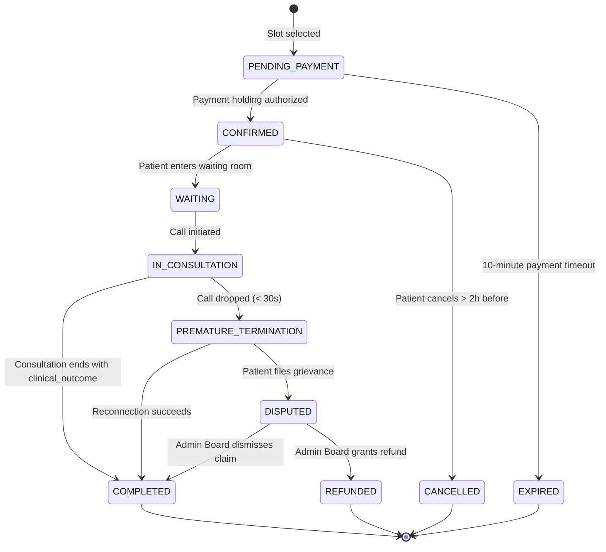
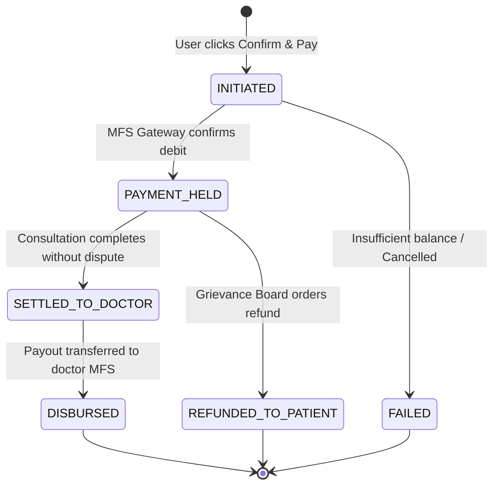
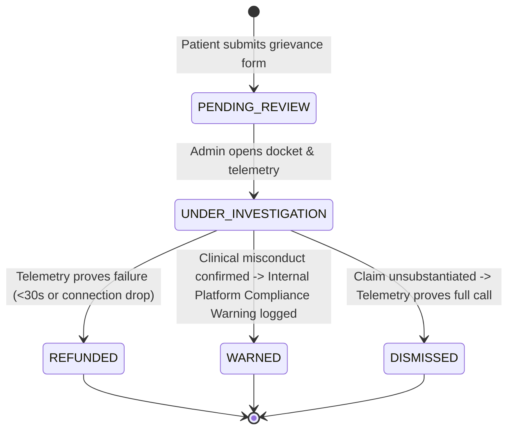
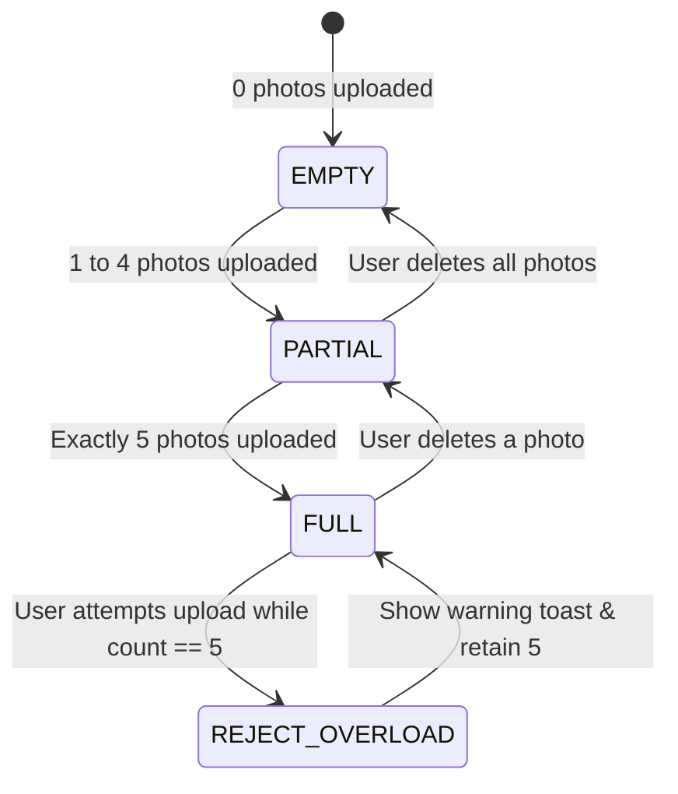
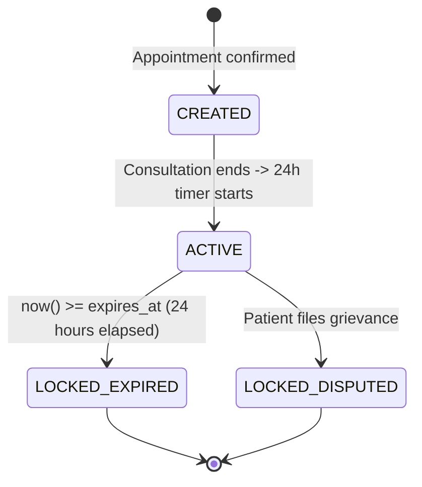

## Current appointment cancellation policy — overrides §2.1 below

**2026-10-10, explicit product decision:** patients can never cancel a booked
consultation, of any status, by any mechanism. No `CONFIRMED -> CANCELLED`
transition (or any other patient-initiated cancellation) exists in the
backend or either Flutter client — a short-lived `PENDING_PAYMENT ->
CANCELLED` self-service endpoint was built and then fully removed the same
day by explicit instruction. `AppointmentStatus::Cancelled` remains a valid
enum/DB value (removing it is unrelated schema churn, not requested), but
nothing in this codebase currently writes it. §2.1's `CONFIRMED -> CANCELLED`
edge and its "Full refund returned to patient" guard below are historical
spec text, not current behavior — do not reintroduce a cancellation path
without a new, explicit instruction. See `docs/CHECKPOINT.md` for the full
removal record.

## Current professional-registration state machine — Kenya

`professional_verification_status`: PENDING → VERIFIED or PENDING → REJECTED.
Both transitions require ClinicalAdmin/PlatformAdmin and commit review metadata,
audit and notification atomically. Concurrent/repeated terminal reviews lose with
409. There is no approved reapplication or terminal-state reversal. Account
suspension/activation, duty, MFA and payout state remain separate controls.
See [current contract](KENYA_PROFESSIONAL_VERIFICATION.md).

# Phase 14 — Formal State Machines & Lifecycle Specifications

> **Document Version:** 1.0.0  
> **Engine:** Deterministic Finite State Automata (FSA)  
> **Target Audience:** Claude Code Autonomous Implementation Agent

---

## 1. Overview & Transition Integrity

To prevent invalid clinical or financial states (e.g., releasing funds before consultation or editing prescriptions after signing), all stateful entities must enforce strict transition matrices with pre-condition guards.

---

## 2. Core State Machines

### 2.1 `AppointmentState`
Controls the lifecycle of a patient's booking.

- **Valid Transitions & Guards:**
  - `PENDING_PAYMENT -> CONFIRMED`: Guarded by verified MFS IPN webhook or gateway token.
  - `PENDING_PAYMENT -> EXPIRED`: Auto-triggered by background job after 600 seconds. Releases slot back to `AVAILABLE`.
  - `IN_CONSULTATION -> COMPLETED`: Guarded by the presence of a set `clinical_outcome` and writes `completed_at = CURRENT_TIMESTAMP`. Note: A prescription is NOT required to complete an appointment, only an outcome. Doctor clinical access expires 24 hours after `completed_at`.
  - `CONFIRMED -> CANCELLED`: Guarded by `appointment_time - now() > 2 hours`. Full refund returned to patient.

---

### 2.2 `PaymentStatusState`
Controls financial holding and settlement under the 20% platform charge model.

- **Settlement Transition (`PAYMENT_HELD -> SETTLED_TO_DOCTOR`):**
  - Gross Inflow: $G$
  - HeloDoc Platform Fee: $C = G \times 0.20$ (Credited to platform revenue ledger)
  - Doctor Net Settlement: $N = G \times 0.80$ (Credited to `doctor_wallets.pending_disbursement` until the Finance-admin batch)

---

### 2.3 `GrievanceState`
Controls patient dispute resolution and Central Medical Governance Board arbitration.

---

### 2.4 `PrescriptionUploadState` (Max 5 Images)
Controls pre-consultation multi-prescription intake.

---

### 2.5 `ChatConversationState` (24-Hour Clinical Desk)

## Doctor Articles ? current direct-publication contract

[Doctor Articles](DOCTOR_ARTICLES.md) defines the implemented `DRAFT / PUBLISHED / ARCHIVED` lifecycle, structured fields, APIs, optimistic versions, forced ownership/publication RLS and migration `20261025000001`. Doctors publish directly; no Admin review state or queue exists. Professional verification remains its separate existing state machine. [Session hardening](PUBLIC_EXPOSURE_HARDENING.md) requires an active JWT `sid` family on protected reads/writes.
